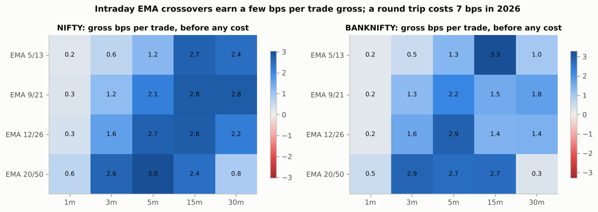
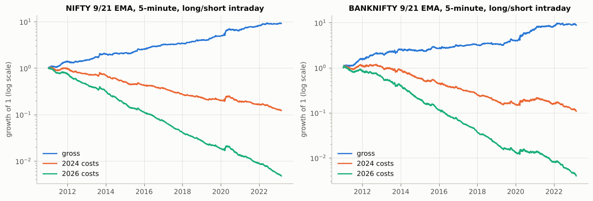
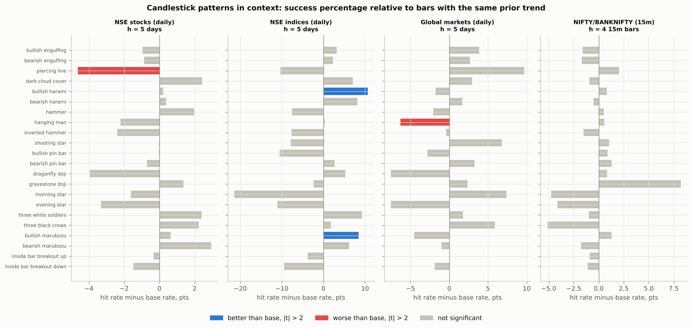

# EMA crossovers and candlestick price action: a backtest study

Branch `EMA`, October 2026. Real historical data for NIFTY 50, BANK NIFTY,
62 NSE stocks and 7 global markets, about 20 years of daily bars and 12
years of 1-minute bars. Every number in this report is produced by the
scripts in this branch (see [Reproduce](#11-reproduce)). Nothing here is
investment advice.

---

## 1. The five questions, answered

**1. Where can crossovers profit in past market data?**
Only in one place: **daily bars, long only, on equity indices and
diversified stock baskets**. On NIFTY 50 from Dec 2007 to Oct 2026, a
20/50 EMA crossover that is long when the fast EMA is above the slow one
and in cash otherwise returned **7.9% a year vs 7.5% for buy and hold,
with a worst drawdown of -27% instead of -60%**, after 2026 futures
costs. If the idle cash earns 6% and dividends are counted, that becomes
**11.0% vs 8.8%**. The edge is risk control rather than extra return: the
rule sidestepped most of 2008 (-22% vs -52%) and gave back a little in
choppy years. Everywhere else, crossovers lose or merely track:
long/short on indices, currencies, hourly bars, and **every intraday
timeframe on NIFTY and BANKNIFTY once costs are paid**.

**2. The EMA strategy.** A full family is implemented and tested in
`ema_lab/strategies.py`: classic dual crossovers (5/20, 9/21, 12/26,
20/50, 50/100, 50/200 and a 99 pair grid), 200 EMA regime filter, ADX
filter, ATR stops and trailing stops, triple EMA alignment, MACD, price
vs EMA, intraday versions with session rules, and the original 9/21
one-minute scalper from the `algo` branch. The best supported rule is in
[section 10](#10-what-to-do-with-this).

**3. Can candlestick price action be automated?** **Yes, completely.**
22 classic patterns (engulfing, hammer, shooting star, pin bars, dojis,
morning/evening star, three soldiers/crows, harami, piercing/dark cloud,
marubozu, inside bar breakouts) reduce to exact inequalities on one to
three bars of OHLC and are implemented in `ema_lab/patterns.py`. The
problem is not automation, it is that **the patterns do not predict**:
across 233,711 occurrences their success percentages sit within about
1-2 points of the base rate for bars with the same prior trend, the
handful of "significant" results is about what chance produces, and
those few fade out of sample.

**4. Success percentages.** See the scoreboards in
[section 2](#2-success-percentage-scoreboard). Crossover rules on Indian
indices win 35-53% of trades and make money because winners are 2-4x the
size of losers. Candlestick trades win a median 35-40% after costs and
mostly lose money.

**5. Report.** This document, with detailed tables in
`results/ema_daily.md`, `results/ema_intraday.md`, `results/candles.md`,
CSVs in `results/tables/` and charts in `results/figures/`.

---

## 2. Success percentage scoreboard

"Success %" is the share of closed trades with a positive return **after
costs** (win rate). Profit factor is gross wins divided by gross losses.
Daily index statistics start after a 200 bar warm-up (NIFTY Dec 2007,
BANKNIFTY Dec 2010) so every rule and buy and hold cover the same window.

### EMA strategies

| Strategy | Market and period | Trades | Success % (win rate) | Profit factor | Avg trade | CAGR | Max DD | Buy and hold CAGR / Max DD |
|---|---|---|---|---|---|---|---|---|
| EMA 20/50 long only, daily | NIFTY 2007-2026 | 34 | 52.9% | 4.00 | +5.65% | 7.9% | -27% | 7.5% / -60% |
| EMA 9/21 long only, daily | NIFTY 2007-2026 | 92 | 42.4% | 2.20 | +1.64% | 6.8% | -29% | 7.5% / -60% |
| EMA 50/200 long only, daily | NIFTY 2007-2026 | 17 | 35.3% | 2.17 | +5.15% | 3.3% | -31% | 7.5% / -60% |
| EMA 20/50 long/short, daily | NIFTY 2007-2026 | 69 | 44.9% | 2.38 | +2.73% | 5.8% | -46% | 7.5% / -60% |
| Close above EMA 50, daily | NIFTY 2007-2026 | 160 | 28.7% | 2.15 | +1.05% | 7.6% | -30% | 7.5% / -60% |
| EMA 20/50 + 3 ATR trailing stop | NIFTY 2007-2026 | 34 | 44.1% | 2.34 | +1.99% | 3.2% | -26% | 7.5% / -60% |
| EMA 12/26 long only, daily | BANKNIFTY 2010-2026 | 60 | 48.3% | 3.66 | +3.27% | 11.3% | -23% | 10.4% / -48% |
| EMA 20/50 long only, daily | BANKNIFTY 2010-2026 | 32 | 43.8% | 3.32 | +4.50% | 7.7% | -22% | 10.4% / -48% |
| EMA 20/50 long only, daily | 62 NSE stocks 2005-2026, equal weight | 2694 | 36.8% | 2.59 (median) | +7.15% | 13.4% | -28% | 18.0% / -61% |
| EMA 20/50 long only, daily | S&P 500 CFD 2005-2020 | 29 | 51.7% | 2.70 | +2.63% | 4.7% | -22% | 6.1% / -57% |
| EMA 50/200 long only, daily | Gold 2006-2020 | 6 | 50.0% | 17.21 | +21.01% | 7.8% | -28% | 7.9% / -45% |
| EMA 20/50 long/short, daily | EUR/USD 2005-2020 | 86 | 25.6% | 0.83 | -0.23% | -1.7% | -42% | -0.8% / -35% |
| EMA 9/21 long/short, 5m intraday, gross | NIFTY 2011-2023 | 10800 | 34.3% | 1.17 | +2.1 bps | 20.0% | -10% | n/a |
| EMA 9/21 long/short, 5m intraday, 2026 costs | NIFTY 2011-2023 | 10800 | 28.1% | 0.72 | -4.9 bps | -35.6% | -100% | n/a |
| EMA 20/50 long/short, 15m intraday, gross | NIFTY 2011-2023 | 3988 | 49.5% | 1.10 | +2.4 bps | 7.6% | -21% | n/a |
| EMA 20/50 long/short, 15m intraday, 2026 costs | NIFTY 2011-2023 | 3988 | 44.3% | 0.83 | -4.6 bps | -14.5% | -87% | n/a |
| Original 1m 9/21 scalper, +8/-5 pts, gross | NIFTY 2011-2023 | 46782 | 44.3% | 1.07 | +0.14 pts | n/a | n/a | n/a |
| Original 1m 9/21 scalper, +8/-5 pts, futures 2026 | NIFTY 2011-2023 | 46782 | 12.8% | 0.04 | -6.66 pts | n/a | n/a | n/a |

### Candlestick patterns

Success % here is the share of pattern occurrences followed by a move in
the predicted direction, from the next bar's open to the close 5 days
(daily) or 4 bars (15-minute) later. Base rate is the same measure for
every bar with the same prior trend, i.e. what you get without the
pattern. The last three columns are the tradable version (stop beyond the
pattern bar, 2R target, time stop) after costs, and what random entries
with the same holding periods earned.

| Pattern (in context) | Universe | Events | Success % | Base rate | t (mean excess) | Trades | Win rate after costs | Avg trade after costs | Random entry avg |
|---|---|---|---|---|---|---|---|---|---|
| bullish engulfing | NSE stocks (daily) | 2215 | 50.0% (5 days) | 51.0% | -0.40 | 2162 | 38.9% | -37 bps | -10 bps |
| bearish engulfing | NSE stocks (daily) | 5315 | 48.6% (5 days) | 49.5% | -0.73 | 5103 | 34.3% | -36 bps | -30 bps |
| hammer | NSE stocks (daily) | 1771 | 52.9% (5 days) | 51.0% | 1.01 | 1720 | 37.8% | -12 bps | -13 bps |
| shooting star | NSE stocks (daily) | 2305 | 49.5% (5 days) | 49.5% | -0.49 | 2233 | 35.1% | -27 bps | -29 bps |
| morning star | NSE stocks (daily) | 304 | 49.3% (5 days) | 51.0% | -0.44 | 304 | 37.8% | -39 bps | -14 bps |
| evening star | NSE stocks (daily) | 587 | 46.2% (5 days) | 49.5% | -0.89 | 585 | 34.7% | -42 bps | -32 bps |
| bullish pin bar | NSE stocks (daily) | 3348 | 50.9% (5 days) | 51.0% | 0.09 | 3236 | 36.8% | -27 bps | -13 bps |
| bearish pin bar | NSE stocks (daily) | 4664 | 48.8% (5 days) | 49.5% | -0.79 | 4490 | 35.5% | -18 bps | -28 bps |
| inside bar breakout up | NSE stocks (daily) | 7361 | 49.7% (5 days) | 50.1% | -0.86 | 6675 | 36.7% | -28 bps | -11 bps |
| bullish engulfing | NIFTY/BANKNIFTY (15m) | 1961 | 47.7% (4 x 15m) | 49.3% | 0.60 | 1690 | 33.1% | -7 bps | -8 bps |
| bearish engulfing | NIFTY/BANKNIFTY (15m) | 2175 | 47.4% (4 x 15m) | 49.1% | -0.46 | 1885 | 33.2% | -7 bps | -6 bps |
| hammer | NIFTY/BANKNIFTY (15m) | 2290 | 49.8% (4 x 15m) | 49.3% | 0.71 | 1906 | 33.9% | -6 bps | -8 bps |
| shooting star | NIFTY/BANKNIFTY (15m) | 1965 | 50.1% (4 x 15m) | 49.1% | 0.93 | 1619 | 34.2% | -6 bps | -6 bps |
| morning star | NIFTY/BANKNIFTY (15m) | 174 | 44.5% (4 x 15m) | 49.3% | -0.65 | 143 | 39.2% | -7 bps | -8 bps |
| evening star | NIFTY/BANKNIFTY (15m) | 161 | 45.0% (4 x 15m) | 49.1% | 0.20 | 143 | 30.8% | -8 bps | -6 bps |
| bullish pin bar | NIFTY/BANKNIFTY (15m) | 2811 | 50.2% (4 x 15m) | 49.3% | 0.42 | 2358 | 34.7% | -6 bps | -8 bps |
| bearish pin bar | NIFTY/BANKNIFTY (15m) | 2670 | 50.4% (4 x 15m) | 49.1% | 0.29 | 2183 | 34.7% | -6 bps | -6 bps |
| inside bar breakout up | NIFTY/BANKNIFTY (15m) | 4116 | 49.9% (4 x 15m) | 50.8% | -1.63 | 3318 | 36.0% | -6 bps | -8 bps |

All 22 patterns in all four universes are in `results/candles.md`.

---

## 3. Data

No commercial feed was reachable from the build environment (Yahoo,
Stooq, NSE, Binance and Kaggle are blocked by its network policy), so
every dataset comes from public GitHub repositories, read anonymously and
converted by `scripts/fetch_data.py`.

| Dataset | Source | Coverage | Used for |
|---|---|---|---|
| NIFTY, BANKNIFTY spot, 1-minute | [aeron7/nifty-banknifty-intraday-data](https://github.com/aeron7/nifty-banknifty-intraday-data) | 2007 (NIFTY) / 2010 (BANKNIFTY) to 28 Feb 2023, 1.45M and 1.2M bars | intraday tests (2011 on), daily NIFTY before 2012 |
| NIFTY_F1, BANKNIFTY_F1 near-month futures, 1-minute | same | 2008/2009 to Feb 2023 | spot vs futures check |
| NSE stocks and indices, daily | [BennyThadikaran/eod2_data](https://github.com/BennyThadikaran/eod2_data) (NSE bhavcopies, split/bonus adjusted, updated weekly) | stocks 1995 to 13 Oct 2026 (used from 2005), indices Feb 2012 to 13 Oct 2026 | daily index and stock tests, candlesticks |
| Global markets, 1-minute to hourly/daily | [FutureSharks/financial-data](https://github.com/FutureSharks/financial-data) (OANDA CFDs, Bitstamp) | S&P 500, Nasdaq 100, EUR/USD, GBP/USD, gold, WTI: Jan 2005 to May 2020; BTC/USD 2012-2017 | out-of-market checks |

Cleaning, all documented in `ema_lab/data.py`:

- **Session**: the 09:08 pre-open auction print is dropped; intraday tests
  start in 2011, the first full year of the 09:15-15:30 session; days
  with fewer than 300 one-minute bars (Muhurat sessions, feed holes) are
  dropped.
- **Bad data**: on two days in 2015 the BANKNIFTY file switches to a
  different instrument mid-session (prices near 1,500). Days with any bar
  more than 25% from the surrounding week's level are dropped; the real
  5 Oct 2012 flash crash (about 15%) stays in.
- **Daily NIFTY/BANKNIFTY** splice the 1-minute file (before Feb 2012)
  onto eod2. Over 2,708 overlapping days the two agree to a median 5 bps
  on close, exactly on high/low, with 0.991 daily return correlation.
- **Corporate actions**: eod2 adjusts most splits and bonuses, but a few
  slip through (ITC 2005, Bharti 2009, Vedanta 2026 demerger, Adani Ent
  2015 demerger). They appear as overnight gaps above 33% with a normal
  session after; real crashes in this universe (Yes Bank 2020, Unitech
  2008, Idea 2020) all fell intraday from a modest open. Prices before
  such gaps are back-adjusted; stock data is used from 2005, as eod2
  warns earlier adjustments are incomplete.
- **Survivorship**: the stock universe is 49 current/recent Nifty 50
  members plus 13 former members that fell out of the index (Yes Bank,
  Vodafone Idea, RCom, Unitech, JP Associates, Suzlon, DLF, Zee, Vedanta,
  UPL, BPCL, IOC, GAIL). It is still tilted toward survivors.

---

## 4. Method

**Execution** (`ema_lab/engine.py`, unit tested in `tests/test_engine.py`):
signals are read at a bar's close and filled at the **next bar's open**,
so nothing uses information from the bar it trades on. Stops and targets
are checked intrabar; a gap through a stop fills at the open, not the
stop; if a bar touches both stop and target, the stop is assumed first.
Intraday strategies take no new entries from 15:00 and are flat by 15:15.
Positions are 1x notional, long or short, compounding.

**Costs** (`ema_lab/costs.py`), charged on every fill:

| Market | Per side | Round trip | Built from |
|---|---|---|---|
| NSE index futures, 2026 | 3.5 bps | 7 bps | STT 0.05% of sell value (raised from 0.02% on 1 Apr 2026), exchange 0.00173%, SEBI, stamp 0.002% buy, Rs 20 brokerage, GST, 1.25 Nifty points slippage |
| NSE index futures, Oct 2024 - Mar 2026 | 2.0 bps | 4 bps | same stack, STT 0.02% |
| NSE stock delivery | 14.5 bps | 29 bps | STT 0.1% both sides, stamp 0.015% buy, exchange, DP charge, 3 bps slippage |
| NSE stock futures (shorts) | 6 bps | 12 bps | futures stack plus wider slippage |
| Global CFDs / BTC | 1-3 bps / 15 bps | 2-6 / 30 bps | typical retail spread plus slippage |

The 2026 futures stack is applied to the whole history. That is
deliberate: the question is whether to trade these rules now.

**Metrics** (`ema_lab/metrics.py`): win rate, average win/loss, payoff,
profit factor, expectancy per trade, CAGR, annualised volatility, Sharpe,
Sortino, max drawdown, exposure, trades per year, and buy and hold over
the identical window. Returns are price returns; section 5.3 adds cash
interest and dividends.

**Is it real or luck?** (`ema_lab/stats.py`):

- **Random entry test**: the same number of trades, the same holding
  periods and directions, at random times, 1,000 times. A long only rule
  in a market that rose 6x will look profitable whatever its timing, so
  this asks whether the timing beats chance. `p_random` below 0.05 means
  it does.
- **Parameter grids** of 99 fast/slow pairs with the **deflated Sharpe
  luck threshold** (Bailey and Lopez de Prado): the best of N zero-skill
  trials is expected to look this good by chance.
- **In-sample / out-of-sample**: pick the best pair on the first half,
  measure it on the second.
- **Candlesticks**: hit rates against same-context base rates, t-stats
  with standard errors clustered by week (daily) or session (15m), a
  multiple-testing count, and split-half replication of anything that
  looks significant.

---

## 5. EMA crossovers on daily bars

### 5.1 NIFTY and BANKNIFTY


Long only rules (in the market when the fast EMA is above the slow one,
in cash otherwise) do what trend following is supposed to do: similar
long run return to buy and hold with less than half the drawdown.

| NIFTY, Dec 2007 - Oct 2026 | Trades | Win rate | PF | CAGR | Sharpe | Max DD | Exposure | p_random |
|---|---|---|---|---|---|---|---|---|
| EMA 5/20 long only | 137 | 35.8% | 1.68 | 4.9% | 0.45 | -25.0% | 61% | 0.49 |
| EMA 9/21 long only | 92 | 42.4% | 2.20 | 6.8% | 0.59 | -28.6% | 61% | 0.33 |
| EMA 12/26 long only | 65 | 49.2% | 2.69 | 6.9% | 0.60 | -37.4% | 62% | 0.29 |
| **EMA 20/50 long only** | 34 | 52.9% | 4.00 | **7.9%** | **0.65** | **-27.4%** | 65% | 0.20 |
| EMA 50/200 long only | 17 | 35.3% | 2.17 | 3.3% | 0.30 | -31.0% | 75% | 0.83 |
| EMA 20/50 long/short | 69 | 44.9% | 2.38 | 5.8% | 0.38 | -45.7% | 100% | 0.08 |
| EMA 50/200 long/short | 34 | 23.5% | 1.05 | -2.7% | -0.04 | -68.3% | 100% | 0.89 |
| Buy and hold | | | | 7.5% | 0.46 | -59.7% | 100% | |

| BANKNIFTY, Dec 2010 - Oct 2026 | Trades | Win rate | PF | CAGR | Sharpe | Max DD | Exposure | p_random |
|---|---|---|---|---|---|---|---|---|
| EMA 9/21 long only | 82 | 42.7% | 2.30 | 8.5% | 0.64 | -30.2% | 60% | 0.35 |
| **EMA 12/26 long only** | 60 | 48.3% | 3.66 | **11.3%** | **0.81** | **-23.0%** | 62% | 0.20 |
| EMA 20/50 long only | 32 | 43.8% | 3.32 | 7.7% | 0.58 | -21.8% | 65% | 0.44 |
| EMA 50/200 long only | 15 | 40.0% | 1.93 | 2.9% | 0.25 | -34.7% | 77% | 0.92 |
| EMA 12/26 long/short | 120 | 43.3% | 2.00 | 9.0% | 0.50 | -35.0% | 100% | 0.06 |
| Buy and hold | | | | 10.4% | 0.55 | -47.9% | 100% | |

What stands out:

- **Long only beats long/short for every pair on both indices.** Shorting
  a market that compounds 8-10% a year costs more in whipsaws than it
  saves in bear markets.
- **The famous 50/200 "golden cross" is the worst long only pair** on
  both indices: it reacts so late that it gives back most of each move.
  Mid-speed pairs (9/21 to 20/50 on NIFTY, 9/21 to 12/26 on BANKNIFTY)
  work best.
- **None of the timing beats random timing at 5%** (`p_random` 0.20 at
  best for long only). The value of these rules is in the shape of the
  return stream (much smaller drawdowns), not in a statistically
  demonstrable ability to pick good days.
- Calendar years tell the story: 2008 buy and hold -51.7%, EMA 20/50 long
  only -22.4%, long/short +4.3%; 2020 +14.9% vs +32.4% vs +41.0%; but in
  sideways years like 2010 (17.6% vs 2.5%) and 2013 (6.8% vs -5.8%) the
  rules lag (full table: `results/ema_daily.md`, A5).

### 5.2 Parameter sensitivity: there is no magic pair


| Grid (99 pairs) | Share beating B&H Sharpe | Share beating B&H CAGR | Share with PF > 1 | Median Sharpe | Best (pair) | Luck threshold |
|---|---|---|---|---|---|---|
| NIFTY long only | 80.8% | 11.1% | 100% | 0.56 | 0.69 (25/50) | 0.78 |
| NIFTY long/short | 0% | 0% | 99% | 0.25 | 0.44 (25/50) | 0.51 |
| BANKNIFTY long only | 30.3% | 1.0% | 100% | 0.44 | 0.78 (10/30) | 0.84 |
| BANKNIFTY long/short | 0% | 0% | 73% | 0.04 | 0.46 (10/30) | 0.54 |

On NIFTY, 4 of 5 long only pairs beat buy and hold on risk-adjusted
return: the result is broad, not a lucky cell. But **the best pair in
each grid is below the luck threshold**, so picking "the" optimal pair
from this chart is data mining. In-sample selection confirms it: the best
NIFTY pair up to 2016 (5/100) ranked 62nd of 99 afterwards (out-of-sample
Sharpe 0.77 vs 0.73 for buy and hold, CAGR 8.0% vs 11.0%); the best
BANKNIFTY pair up to 2017 (20/40) ranked 31st (Sharpe 0.48 vs 0.51).

### 5.3 Filters, variants and the cash you are not counting

| NIFTY variants, long only | Trades | Win rate | CAGR | Sharpe | Max DD | Exposure |
|---|---|---|---|---|---|---|
| EMA 20/50 | 34 | 52.9% | 7.9% | 0.65 | -27.4% | 65% |
| + close above EMA 200 regime filter | 28 | 46.4% | 2.6% | 0.33 | -38.1% | 47% |
| + ADX > 20 at entry | 11 | 45.5% | 3.3% | 0.42 | -22.2% | 22% |
| + 2 ATR stop | 34 | 38.2% | 4.3% | 0.42 | -28.4% | 46% |
| + 3 ATR trailing stop | 34 | 44.1% | 3.2% | 0.43 | -26.0% | 22% |
| Triple EMA 10/20/50 | 70 | 47.1% | 6.3% | 0.60 | -28.8% | 53% |
| MACD 12/26/9 | 178 | 38.2% | 4.0% | 0.39 | -27.8% | 49% |
| Close above EMA 50 | 160 | 28.8% | 7.6% | 0.65 | -30.3% | 64% |
| Close above EMA 200 | 78 | 24.4% | 4.7% | 0.41 | -40.6% | 73% |

**Filters do not help.** Every popular add-on (200 EMA regime, ADX,
stops) cuts trades and exposure but also cuts return more than risk. The
plain crossover is as good as anything. The single EMA rule "be long
while close is above EMA 50" matches it with a win rate of just 28.8%, a
reminder that win rate is not the goal.

Price-only backtests also understate rules that sit in cash a third of
the time. With 6% a year on idle cash (overnight TREPS averaged about
5.4% over 2016-2026 per the NIFTY 1D Rate Index; T-bills paid more
before) and 1.3% dividends for whoever holds the index:

| Total return view | CAGR | Sharpe | Max DD | Buy and hold CAGR / Sharpe / Max DD |
|---|---|---|---|---|
| NIFTY EMA 20/50 long only | 11.0% | 0.87 | -23.6% | 8.8% / 0.52 / -59.3% |
| NIFTY EMA 20/50 + 3 ATR trailing stop | 8.2% | 1.05 | -13.2% | 8.8% / 0.52 / -59.3% |
| NIFTY close above EMA 50 | 10.8% | 0.89 | -26.4% | 8.8% / 0.52 / -59.3% |
| BANKNIFTY EMA 20/50 long only | 10.9% | 0.77 | -20.4% | 11.9% / 0.61 / -47.7% |
| BANKNIFTY EMA 20/50 + 3 ATR trailing stop | 9.7% | 1.08 | -11.6% | 11.9% / 0.61 / -47.7% |

### 5.4 Across 62 NSE stocks


| EMA long only, delivery costs | Median CAGR (B&H) | Beats B&H CAGR | Beats B&H Sharpe | PF > 1 | Mean win rate | Median max DD (B&H) |
|---|---|---|---|---|---|---|
| 9/21, all 62 | 8.1% (12.7%) | 29.0% | 40.3% | 91.9% | 35.2% | -52.1% (-69.5%) |
| 20/50, all 62 | 8.6% (12.7%) | 27.4% | 35.5% | 96.8% | 36.8% | -51.9% (-69.5%) |
| 20/50, 49 survivors | 8.8% (13.8%) | 18.4% | 32.7% | 100% | 37.9% | -49.4% (-66.4%) |
| 20/50, 13 former members | 5.0% (-0.1%) | 61.5% | 46.2% | 84.6% | 32.9% | -74.5% (-88.9%) |
| 50/200, all 62 | 8.4% (12.7%) | 19.4% | 21.0% | 93.5% | 42.5% | -55.2% (-69.5%) |

Single stocks are harder: ~29 bps round trip delivery costs and violent
gaps make each stock's crossover lag its buy and hold in about 3 of 4
cases. The exception is exactly the case trend following exists for:
**stocks that collapsed** (Yes Bank, RCom, Unitech, JP Associates), where
the rule got out and beat buy and hold 62% of the time. As an equal weight
portfolio, diversification turns that into a good risk-adjusted profile:

| Equal weight, 62 stocks | CAGR | Volatility | Sharpe | Max DD |
|---|---|---|---|---|
| EMA 9/21 long only | 13.6% | 11.0% | 1.21 | -28.5% |
| EMA 20/50 long only | 13.4% | 11.5% | 1.15 | -28.0% |
| EMA 50/200 long only | 12.0% | 12.4% | 0.97 | -28.6% |
| Buy and hold | 18.0% | 20.2% | 0.92 | -60.9% |

The buy and hold line is flattered by survivorship (most of the universe
is today's Nifty 50); the EMA portfolio sat in cash about 40% of the time
and earned nothing on it here.

### 5.5 Outside India

| Daily, Jan 2005 - May 2020 | Best long only rule: CAGR / Max DD | Buy and hold CAGR / Max DD | Long/short 20/50 CAGR |
|---|---|---|---|
| S&P 500 CFD | 20/50: 4.7% / -22% | 6.1% / -57% | 0.4% |
| Nasdaq 100 CFD | 50/200: 9.5% / -31% | 12.9% / -53% | -5.0% |
| Gold | 50/200: 7.8% / -28% | 7.9% / -45% | 0.0% |
| WTI crude | 9/21: 8.6% / -31% | -7.7% / -92% | 4.1% |
| EUR/USD | 50/200: 0.2% / -23% | -0.8% / -35% | -1.7% |
| GBP/USD | 20/50: -0.0% / -19% | -2.5% / -46% | 2.0% |
| BTC/USD 2012-2017 | 20/50: 296% / -70% | 285% / -85% | 241% |

The same shape repeats: in equities and gold, crossovers give up some
return for far smaller drawdowns; in currencies they do nothing useful.
On **hourly bars** almost every rule on the S&P 500, Nasdaq, EUR/USD and
GBP/USD loses after costs (`results/ema_daily.md`, C1).

---

## 6. EMA crossovers intraday (NIFTY and BANKNIFTY, 2011 - Feb 2023)



Long/short crossovers inside the session, flat by 15:15. Across 5
timeframes (1, 3, 5, 15, 30 minutes) and 4 pairs (5/13, 9/21, 12/26,
20/50) on both indices:

- **There is a real signal before costs.** 5 to 15 minute crossovers earn
  +1.2 to +3.3 bps per trade gross. The NIFTY gross signal persisted out
  of sample: the best 2011-2017 configuration (5m 12/26) had a 2018-2023
  gross Sharpe of 1.58, and 95% of configurations stayed gross-positive.
  The timing beats random entry times (p < 0.01).
- **It is smaller than the cost of trading it.** On 5 to 15 minute bars
  the break-even cost is about 0.6-1.6 bps per side; the 2026 futures cost
  is 3.5 bps (STT alone is 2.5 bps per side on average) and the 2024 stack
  was 2.0. **All 40 configurations lose money after 2026 costs, and all
  40 after 2024 costs.** One-minute crossovers earn 0.2-0.6 bps gross and
  trade 1,800-6,900 times a year.
- **On the tradable futures the gross edge is smaller still**: NIFTY_F1
  5m 9/21 earns +1.9 bps (spot +2.1), 5m 20/50 +1.6 (spot +3.0), and
  BANKNIFTY_F1 15m 9/21 is negative. One-minute return autocorrelation is
  near zero on both, so stale index prices are not creating the signal.



| NIFTY 9/21, 5-minute bars | Trades/yr | Gross win rate | Gross bps/trade | Net win rate | Net bps/trade | Net CAGR |
|---|---|---|---|---|---|---|
| base (fresh cross only) | 681 | 32.5% | +2.5 | 27.2% | -4.5 | -27.0% |
| + ADX(14) > 25 | 135 | 32.8% | +0.2 | 27.4% | -6.8 | -8.9% |
| + windows 09:30-11:30, 13:30-14:45 | 363 | 33.4% | +1.6 | 27.6% | -5.4 | -18.0% |
| + 5m close vs EMA 200 | 349 | 35.5% | +3.3 | 29.8% | -3.7 | -12.3% |
| + prior day's daily EMA 20 slope | 329 | 33.2% | +2.3 | 27.6% | -4.7 | -14.7% |
| all four filters | 19 | 31.7% | -1.7 | 24.2% | -8.7 | -1.6% |

Filters cut trades but not the problem: none lifts gross expectancy
anywhere near the 7 bps round trip. Win rates are highest in the first
hour and after 14:00 (about 40%) and lowest from 10:00 to 13:00 (26-28%),
but no hour earns more than about 3 bps per trade gross, so no time
window fixes the cost problem.

**The original idea from the `algo` branch** (9/21 on 1-minute bars,
+8/-5 index point target/stop, about +4/-2.5 option premium points at 0.5
delta, 5 bar time stop) has essentially **zero gross edge**: +0.14 index
points per trade on NIFTY at a 44% win rate, negative on BANKNIFTY. After
futures costs it wins 13% of the time; even at an option-like 4 index
points per round trip it wins 24% and loses 3.9 points per trade, across
3,850 trades a year. Widening the target/stop to 15/10 or 25/15 does not
change the gross picture. This confirms the algo branch's Monte Carlo
conclusion with real data.

---

## 7. Candlestick price action

### 7.1 Can it be automated? Yes

Every pattern reduces to inequalities on the open, high, low and close of
one to three bars. For example (all in `ema_lab/patterns.py`):

- **Bullish engulfing**: prior bar bearish, current bar bullish, current
  open at or below the prior close, current close at or above the prior
  open, current body larger.
- **Hammer**: body at most 35% of the range, lower shadow at least twice
  the body, upper shadow at most 10% of the range; counts as bullish only
  after a decline.
- **Pin bar**: wick at least 2/3 of the range, close in the opposite
  third, wick makes a new low (bullish) or high (bearish) versus the prior
  bar.
- **Morning star**: long bearish bar (body above its 10 bar average), a
  small body (at most half the first) whose body stays at or below the
  first close, then a bullish bar closing above the first bar's midpoint.

The parts a discretionary trader adds by eye are encoded explicitly:

- **"Long" and "small" bodies** are measured against the average of the
  previous 10 bars, which also keeps the pattern from setting its own
  yardstick.
- **Context** (the hammer must follow a decline) is a separate rule, so
  it can be tested on its own: prior 5 bar move and close vs 20 EMA.
  Reversal patterns count only against the prior trend, continuation
  patterns only with it.
- **Gaps** that the classic star and piercing patterns require are rare
  on NSE daily bars, so those rules accept a touch instead of a strict
  gap.

Detection is vectorised and covers 233,711 pattern occurrences across all
universes in seconds. A pattern is known at the bar's close, so it can be
traded live from the next open with any broker API (or from a stop order
beyond the pattern bar). Automation is not the obstacle.

### 7.2 Do the patterns predict? Mostly no



For every pattern, universe and horizon (1, 5, 10 days; 1, 4, 8
fifteen-minute bars), the success percentage was compared with the base
rate for bars with the same prior trend:

- On **NSE stocks** (131,899 occurrences) the median in-context gap
  between a pattern's success rate and its base rate is **1.5
  percentage points**. On **15-minute NIFTY/BANKNIFTY bars** (85,075
  occurrences) it is **1.2 points**. Bullish engulfing on stocks: 50.0%
  vs 51.0%. Hammer: 52.9% vs 51.0%. Shooting star: 49.5% vs 49.5%.
- **30 of 516 tests reach |t| > 2 (5.8%); pure chance gives about 4.6%.**
  Several of the 30 go the wrong way (piercing line on stocks underperforms
  its base rate, t = -2.1).
- **The significant ones do not replicate.** Split each universe's history
  in half and re-test:

| Finding (h = 5 days) | Full sample t | First half t | Second half t |
|---|---|---|---|
| Bullish harami, NSE indices | 2.85 | 3.60 | 0.58 |
| Bullish marubozu in uptrend, NSE indices | 2.41 | 2.42 | 0.54 |
| Bearish marubozu, NSE stocks (continuation) | 3.36 | 2.97 | 1.66 |
| Piercing line after decline, NSE stocks (worse than base) | -2.12 | -1.11 | -1.89 |
| Hanging man after rise, global markets (worse than base) | -2.43 | -2.54 | -0.78 |

The only effect that holds direction in both halves is that a strong
bearish candle on a stock tends to be followed by more weakness: a
momentum effect, not a reversal signal, and weaker in recent years.

### 7.3 Tradable versions lose after costs

Each pattern traded in context: enter at the next open, stop beyond the
pattern bar's extreme (plus 0.1 ATR), 2R target, 10 day (or 8 x 15m) time
stop, with real costs, and compared with random entries that keep the
same holding periods and directions.

| Universe | Trades | Patterns profitable after costs | 95% CI above zero | Beat random entries (p < 0.05) | Median win rate | Median trade |
|---|---|---|---|---|---|---|
| NSE stocks, daily | 56,170 | 3 of 22 | 0 | 1 (still loses money) | 36.6% | -25 bps |
| NIFTY/BANKNIFTY, daily | 1,620 | 13 of 22 | 1 | 2 | 40.1% | +6 bps |
| Global markets, daily | 5,597 | 6 of 22 | 1 | 0 | 38.1% | -8 bps |
| NIFTY/BANKNIFTY, 15m | 31,480 | 0 of 22 | 0 | 5 (all lose money) | 34.7% | -6 bps |

The one candidate, a bullish marubozu in an uptrend on NIFTY/BANKNIFTY
daily (+97 bps per trade, 116 trades, 53% win rate, beats random entry
p = 0.014), is the same effect that faded to t = 0.5 in the second half
above. On 15-minute bars several patterns time better than random, but
none clears the 7 bps round trip, the same story as intraday EMAs.

### 7.4 EMA trend + candle trigger

A popular combination: trade only with the trend (EMA 20 above EMA 50,
close above EMA 50), wait for a pullback to the 20 EMA, enter on a
bullish candle (engulfing, hammer, pin bar, morning star, piercing).
Compared with control entries that keep the setup and drop the candle:

| Long side, after costs | Candle trigger | Control: any bullish close | Control: any bar at the EMA | Random entries |
|---|---|---|---|---|
| NSE stocks | -2.3 bps (37.5% win) | -3.9 bps | -18.7 bps | +4.7 bps |
| NIFTY/BANKNIFTY daily | +7.3 bps | +4.9 bps | +0.2 bps | +12.6 bps |
| Global markets daily | +35.5 bps | +13.1 bps | +9.4 bps | +42.3 bps |
| NIFTY/BANKNIFTY 15m | -6.3 bps | -6.7 bps | -7.1 bps | -8.0 bps |

The candle adds little beyond "the bar closed up". On daily bars none of
the versions beats random long entries in the same markets; on 15-minute
bars all three time slightly better than random and all three lose money
after costs. Whatever works here is the trend filter, not the candle.

---

## 8. How this fits the published research

- Brock, Lakonishok and LeBaron (1992, *Journal of Finance* 47(5)) found
  moving average rules on the Dow Jones from 1897 to 1986 produced buy
  signal returns higher and less volatile than sell signal returns,
  inconsistent with random walk and GARCH nulls.
- Sullivan, Timmermann and White (1999, *Journal of Finance*) tested the
  same family with a data-snooping correction (White's Reality Check);
  the best rule's performance in the following decade was not
  statistically significant. The grid and out-of-sample results in
  section 5.2 show the same thing on Indian data: broad, modest benefits,
  but no reliable "best" pair.
- Park and Irwin (2007, *Journal of Economic Surveys* 21(4)) reviewed 95
  modern studies: 56 positive, 20 negative, 19 mixed, with warnings about
  data snooping, ex post rule selection and underestimated costs. Our
  intraday results are a concrete case of the last point.
- Marshall, Young and Rose (2006, *Journal of Banking and Finance*) found
  candlestick strategies did not create value on Dow Jones stocks over
  1992-2002, consistent with sections 7.2-7.3 on NSE stocks.
- Trend following as a portfolio strategy is best documented with
  12-month time-series momentum across many futures markets (Moskowitz,
  Ooi and Pedersen 2012; Hurst, Ooi and Pedersen 2017). The equal weight
  stock result in 5.4 is a small version of why: diversification across
  many trend signals is what turns lower drawdowns into a high Sharpe
  ratio.

---

## 9. Limitations

- **Costs and taxes**: one cost stack per market for the whole history,
  constant slippage, no market impact. Taxes are ignored; in India
  short-term gains are taxed at 20% against 12.5% long-term (above the
  Rs 1.25 lakh exemption), so a rule that realises gains every few months
  loses more to tax than buy and hold, which also defers tax.
- **Price returns** for the main tables: no dividends and no interest on
  idle cash except in the total return view (5.3). For index futures,
  monthly rolls (roughly 6-7 bps each at 2026 STT, about 0.8% a year
  while invested) are not charged; an index ETF avoids them.
- **Data**: public GitHub datasets, cleaned and cross-checked (section 3)
  but not vendor grade. NSE intraday data ends Feb 2023, global data May
  2020, BTC 2017. The daily NSE data runs to 13 Oct 2026.
- **Survivorship**: reduced, not removed, in the stock universe.
- **Options**: intraday tests use index or futures prices. Option buying
  changes the cost structure (STT on premium, not notional, but adds
  theta and wider spreads); without historical option premiums it is not
  modelled beyond the index point approximation in section 6.
- **Many tests**: thousands of configurations were run. The conclusions
  lean on what is broad (whole grids, whole universes, both halves of the
  sample), not on the single best number in any table.

---

## 10. What to do with this

**If you want one EMA rule, the evidence supports this one, and only in
this form:**

> **Daily NIFTY 50 (or BANK NIFTY) trend filter, long only.** At each
> daily close compute EMA 20 and EMA 50 of the index close. If EMA 20 is
> above EMA 50, hold the index from the next open (index ETF, or futures
> rolled monthly); otherwise hold cash in a liquid fund. No stops, no
> shorting, no parameter tuning (12/26 or "close above EMA 50" are
> equivalent choices).

Historically that meant about 2 trades a year, about a 50% success
rate, a profit factor near 4, roughly buy and hold returns, and half the
drawdown. Its job is to keep you out of 2008-style bear markets, not to
beat the market in normal years, and it will lag in sideways years. A 3
ATR trailing stop is the option for a smoother ride: Sharpe above 1 and
drawdowns of 12-13% in the total return view, for a few points of CAGR.

**What not to do, based on this data:**

- Do not trade intraday EMA crossovers on NIFTY/BANKNIFTY futures at 2026
  costs. The signal is real but about a third of the round trip cost, and
  STT alone (2.5 bps per side) exceeds the break-even.
- Do not short index trends; long/short is worse than long only on every
  Indian index tested.
- Do not optimise the EMA pair. The best in-sample pair was mid-table
  out of sample.
- Do not trade candlestick patterns standalone, intraday or daily. Use
  them, if at all, as a visual aid, not as an entry rule.

**Worth testing next:**

1. A diversified trend portfolio (several NSE indices, gold, US equities,
   with volatility-scaled positions); section 5.4 suggests the gain comes
   from breadth.
2. Walk-forward re-optimisation and an India VIX regime filter.
3. Real option premium data (broker historical API) for the option buying
   versions, and NSE intraday data after Feb 2023.
4. Paper trade the daily rule for a few months before committing capital.

---

## 11. Reproduce

```
pip install -r requirements.txt
python scripts/fetch_data.py          # partial, sparse clones of the three data repos
python scripts/run_ema_daily.py       # sections 5   -> results/ema_daily.md
python scripts/run_ema_intraday.py    # section 6    -> results/ema_intraday.md
python scripts/run_candles.py         # section 7    -> results/candles.md
python scripts/build_scoreboard.py    # section 2    -> results/scoreboard.md
python -m pytest tests                # engine execution rules
```

The three experiment scripts take under a minute each once the data is
built. `scripts/fetch_data.py` downloads only the files it needs (a few
hundred MB); the full intraday repository is about 22 GB.

### Sources

- Data: [aeron7/nifty-banknifty-intraday-data](https://github.com/aeron7/nifty-banknifty-intraday-data),
  [BennyThadikaran/eod2_data](https://github.com/BennyThadikaran/eod2_data),
  [FutureSharks/financial-data](https://github.com/FutureSharks/financial-data).
- STT changes from 1 April 2026: [5paisa](https://www.5paisa.com/news/stt-hike-on-fo-to-take-effect-from-april-1-amid-rising-options-activity),
  [Groww](https://groww.in/blog/what-is-stt).
- [Brock, Lakonishok and LeBaron (1992)](https://ideas.repec.org/a/bla/jfinan/v47y1992i5p1731-64.html);
  [Sullivan, Timmermann and White (1999), working paper version](https://www.fmg.ac.uk/sites/default/files/2020-11/dp303.pdf);
  [Park and Irwin (2007)](https://ideas.repec.org/a/bla/jecsur/v21y2007i4p786-826.html);
  [Marshall (Massey University thesis behind Marshall, Young and Rose)](https://mro.massey.ac.nz/items/edc6c1cf-63d9-4c94-a13d-92ffe1a53481/full).
