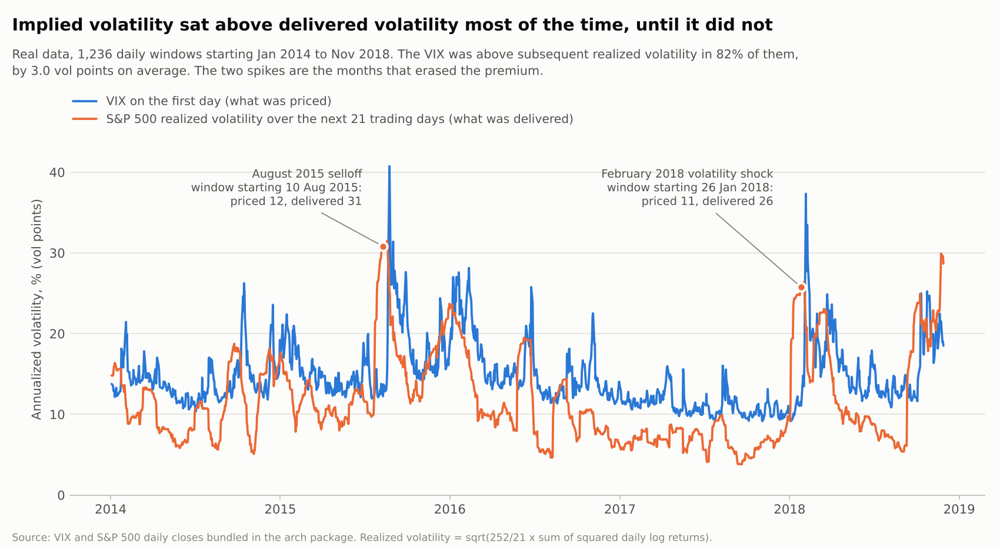
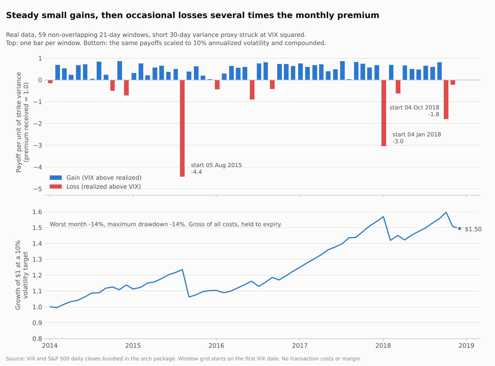
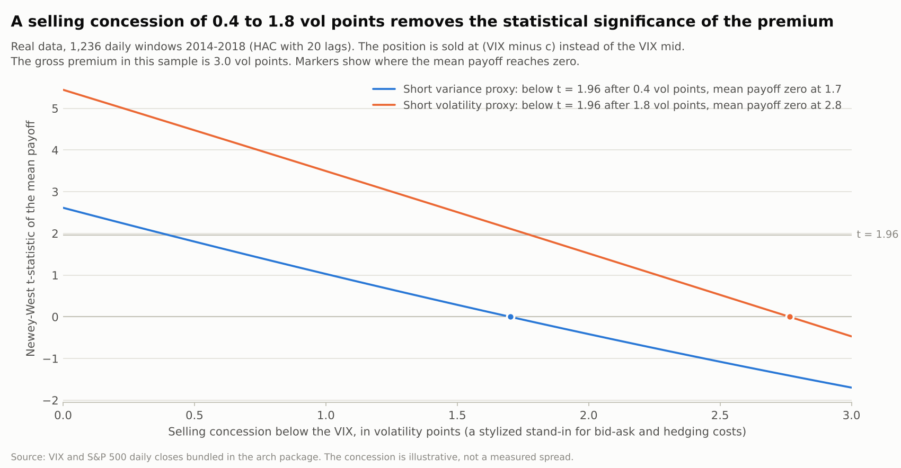
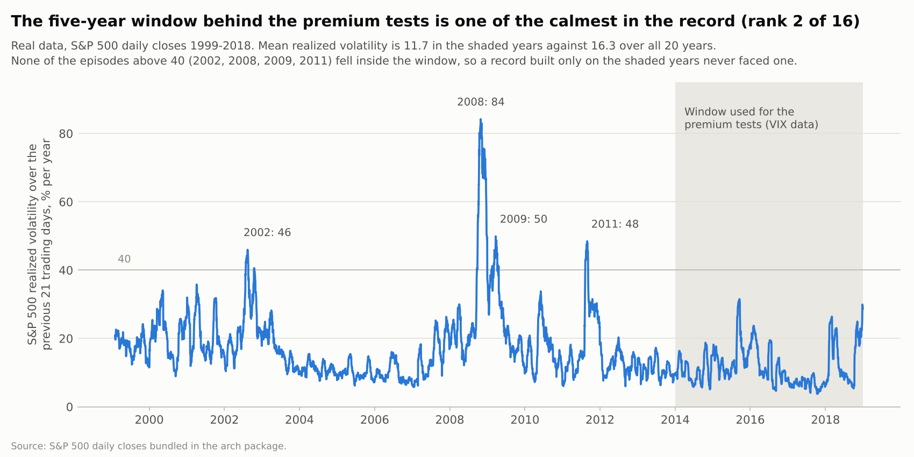
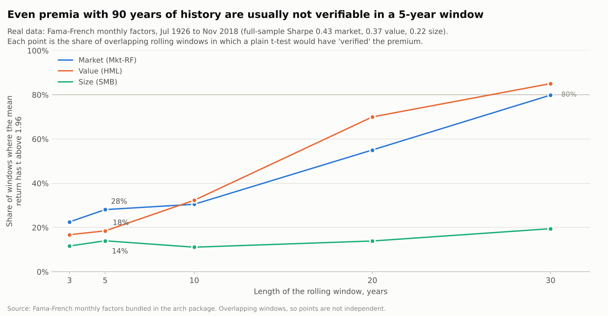
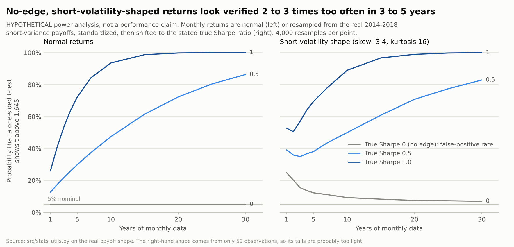

# Verifiable option-trading edges: what survives scrutiny

Branch `verify`. Working session on 2026-10-12. Every number below traces either to a file in `results/` (computed here from real data by the scripts in `scripts/`) or to a row in `ledger/claims.md` (reported by a source and not re-derived here). Row ids such as A11 or F19 refer to that ledger.

## 1. Bottom line

No strategy I examined meets the bar for a definite, verifiable edge: a positive expected profit after realistic costs, supported by statistics that survive fat tails and multiple testing, persisting out of sample, with a worst case an ordinary account can survive. The best-supported candidates are risk premia. They pay on average because they carry crash risk, which is different from a mispricing that can be harvested safely.

What the evidence supports, strongest first:

1. **Structural rules that are definite but are not trading alpha.** US broad-based index options (SPX, NDX, RUT) are Section 1256 contracts: gains and losses are taxed 60% long-term and 40% short-term whatever the holding period, and are marked to market at year end (D1). SPX options are European and cash settled, which removes assignment risk and is what makes box-spread financing workable (F22). These are rules, not statistics. They improve what you keep after tax. They do not create a pre-tax edge.
2. **An S&P 500 volatility risk premium exists on average.** Implied volatility has exceeded subsequent realized volatility by about 4.1 volatility points over roughly 35 years (F18), and by 3.0 points in the 2014 to 2018 data I tested, with the VIX above realized volatility in 82% of 21-day windows. The literature reads it as compensation for crash risk, concentrated at short maturities (A2, F14) and tied to crash risk (A3, A14). My tests found it statistically detectable in that sample, gross of costs, and also found five reasons it is not a definite edge (section 4): a selling concession of about 1.7 vol points erases the mean payoff of the variance proxy, one bad window erases about 19 months of average gains, the sample was among the calmest in the record, the track record is far too short to verify, and naive significance tests are inflated for this return shape.
3. **Single-stock option anomalies and event trades have the strongest gross statistics in the literature, but their status net of costs for a non-institutional trader is unresolved.** Examples are the realized-minus-implied volatility spread, idiosyncratic volatility, skewness, machine-learning characteristic sorts and pre-earnings straddles (B1 to B4, F8, F10, F12). Authors of several papers report profits after their cost assumptions (B2, B3, A11). Other work finds costs and margin erode most of it (F8, F11). I found no independent live replication and no measurement of post-publication decay for option anomalies (F17).
4. **Popular retail structures have negative evidence.** Retail 0DTE buying, cheap weekly out-of-the-money options, long out-of-the-money puts as protection and "free yield" covered-call products show losses or costs that exceed the premium in the best evidence I found (C2, C3, F4, F6, F7, C6). Regulator data from India put the share of individual derivatives traders who lost money at 91% to 93% (C5). A static-rule study of systematic 0DTE strategies found no consistent profitability (F5).

What I could not do is as important as what I did. The environment's egress policy blocked every market-data host I needed, so I ran no option-level backtest, no index-level test on actual PUT or BXM series, and no VIX-futures test. The literature was reached only through web-search summaries, so those numbers are second-hand. Section 7 lists exactly what to unlock to finish the job.

## 2. The test applied

A claim counts as a verifiable edge only if it passes all six:

1. **Mechanism.** Who is on the other side and why do they pay?
2. **Statistics.** Enough independent observations, with inference that respects fat tails, autocorrelation and the number of variants tried.
3. **Costs and margin.** Net of realistic bid-ask, hedging, fees, financing and margin.
4. **Persistence.** Out of sample and after publication.
5. **Survivability.** The worst plausible loss, and the path to it, fit inside the account.
6. **Access.** A non-institutional trader can trade it at the assumed prices.

Labels used in the tables: *Verified here* (computed from real data in this repo), *Published gross*, *Published net* (net under the authors' own cost model), *Commentary only*, *Negative evidence*, *Rule* (structural).

## 3. What was possible in this environment

- **Blocked by the network policy:** cdn.cboe.com, www.cboe.com, fred.stlouisfed.org, stooq.com, query1.finance.yahoo.com, mba.tuck.dartmouth.edu, www.dolthub.com, www.alphavantage.co, export.arxiv.org, papers.ssrn.com, www.aqr.com, api.nasdaq.com. Package registries and raw GitHub content were reachable. A request to attach one public VIX-history repository to the session was denied and I did not route around it. The hosts were re-probed several times during the session and stayed blocked.
- **Real data used** (bundled in the Python `arch` package): S&P 500 daily OHLC 1999-01-04 to 2018-12-31; VIX daily closes 2014-01-03 to 2019-01-03; Fama-French monthly factors 1926-07 to 2018-11; Nasdaq composite daily (used only in tests). The VIX series matches known extremes: low 9.14 on 2017-11-03 and high 40.74 on 2015-08-24, and the one-day jump on 2018-02-05 is 17.31 to 37.32 (+115.6%), against +117% in a published summary (`results/event_check.json`).
- **Not done:** no simulated or modelled option P&L is offered as evidence. One analysis is hypothetical and labelled as such (the power analysis in section 4.5).
- **Checks on the code:** 14 unit tests (`tests/`) including proofs that forward and trailing windows use only the intended returns and that no rule weight changes when future data is removed. One test I wrote had the wrong expected value, which I corrected; the code matched the published formula.
- **Provenance of literature numbers:** the full text of papers could not be opened. Where a number could not be recovered I left it out (for example the exact monthly return in Goyal and Saretto 2009, and the sample period of Zhan, Han, Cao and Tong 2022). See ledger row F24.

## 4. Real-data results (2014 to 2018 VIX, 1999 to 2018 S&P 500)

The test object is the short side of a 30-day variance swap proxy struck at VIX squared, plus a volatility-swap proxy struck at the VIX. Payoffs are per unit of strike, so a premium of 1.0 is collected and realized variance is paid out. All results are gross of costs and of margin. The sample has 1,236 daily 21-trading-day windows (59 non-overlapping).

### 4.1 The premium is there



- Mean VIX 14.7 against mean realized volatility 11.7: a gap of 3.0 vol points. The VIX was above realized volatility in 81.7% of windows (80.9% to 81.7% for 20 to 22 day windows). Realized variance averaged 73% of the strike variance.
- Short variance proxy: mean payoff +0.236 of the strike per window. Annualized Sharpe 0.94 averaged over the 21 possible monthly window grids (range 0.61 to 1.24). Volatility proxy: Sharpe 1.95 (range 1.67 to 2.16).
- Gross significance: HAC t = 2.6 for the variance proxy (2.3 to 3.2 across 10 to 63 lags) and 5.4 for the volatility proxy (4.7 to 6.6). A bootstrap null that preserves the tails gives one-sided p = 0.007 for the variance proxy (worst start grid 0.054) and no bootstrap draw reached the observed mean for the volatility proxy (p below 0.0003 on every grid).
- By calendar year, mean variance payoff per window: 2014 +0.31, 2015 -0.01, 2016 +0.45, 2017 +0.60, 2018 -0.20. In two of five years the average was flat or negative.
- The VIX squared over-predicts realized variance: the slope of realized variance on VIX squared is 0.49 (t = -6.5 against 1), R-squared 0.18. Trailing realized variance adds nothing.
- Descriptively, the gap is larger when the VIX is high: 2.4 vol points when the VIX started at 9.1 to 12.5, 2.6 at 12.5 to 15.2 and 4.1 at 15.2 to 40.7. The worst windows came from selling at low VIX levels (worst payoff -5.3, against -3.3 in the top tercile). This is a description of 1,236 overlapping windows, not a validated rule (section 4.6).
- A range-based realized-variance estimator shows an even larger gap (4.5 vol points, t = 7.1) but averages only 83% of the close-to-close variance, so I kept close-to-close because it matches the contract definition.

### 4.2 Small gains, lumpy losses



- 81% of windows gain. Skew is -3.4 and kurtosis 16.4. The three worst non-overlapping windows start 5 Aug 2015 (payoff -4.44; VIX 12.5, delivered 29.2, S&P 500 -7.3%), 4 Jan 2018 (-3.03) and 4 Oct 2018 (-1.79). Across all 21 start grids the worst window starts 10 Aug 2015 at -5.35 (-5.25 if the swap is capped at 2.5 times strike volatility).
- The worst window erases 19.2 months of average gains for the variance proxy and 6.4 for the volatility proxy.
- Scaled to 10% annualized volatility and compounded, the variance proxy has a worst month of -14.0%, a maximum drawdown of -14.0% and a CAGR of 8.5% (final value $1.50 over 4.9 years). At a 30% volatility target the worst month is -41.9%. These ignore margin calls and costs.
- The payoff is short gamma: beta +21 per unit of 21-day S&P 500 log return (t = 3.7) and a squared-return coefficient of -330 (t = -3.5), R-squared 0.45 rising to 0.62. A linear CAPM alpha is not significant (t = 0.8 on the monthly grid) and is the wrong benchmark for a nonlinear payoff, which is the Broadie, Chernov and Johannes (2009) point (A3).

### 4.3 Costs, and the VIX is not the price of an ATM option



- Selling at the VIX minus c vol points: the variance proxy's mean payoff falls from +0.236 at c = 0 to +0.109 at c = 1.0 and -0.053 at c = 2.0. The break-even concession is 1.70 vol points and the HAC t falls below 1.96 after 0.4. For the volatility proxy the break-even is 2.76 and significance goes after 1.8.
- c is a stylized stand-in. I could not find a sourced SPX bid-ask in vol points (F24). One vendor article gives a rule of thumb that the VIX is about 1.1 to 1.2 times 30-day at-the-money implied volatility (F19), which at VIX 11 to 17 is roughly 1.5 to 2.5 vol points. A seller of at-the-money options therefore does not collect the VIX-based premium. Whether the lower tail sensitivity of a straddle offsets that gap cannot be tested without option prices.
- Constantinides, Czerwonko, Jackwerth and Perrakis report a net-of-cost utility gain from writing rich S&P 500 futures options out of sample over 1983 to 2006 (A11). That is their finding on a different sample and instrument, not something reproduced here.

### 4.4 The sample was calm



- Mean 21-day realized volatility was 11.7 in 2014 to 2018 against 16.3 over 1999 to 2018. That block ranks 2nd calmest of 16 rolling five-year blocks (2013 to 2017 is calmer at 11.0).
- Realized volatility at or above 40 occurred in 2.8% of all windows and in none of the 2014 to 2018 windows. The episodes are 2002 (peak 46), September 2002 (41), 2008 (84), 2009 (50) and 2011 (48). The worst 21-day log return was -35.7% against -12.0% inside the window.
- Arithmetic, not data: per unit of strike variance a short variance position pays 1 minus (RV/VIX) squared. At a VIX of 15 that is -6.1 at realized volatility 40, -15.0 at 60 and -27.4 at 80 if uncapped. A capped swap limits the loss to -5.25. Defined-risk option structures cap the loss differently.
- So +0.236 per window and a Sharpe near 0.9 describe a calm sample, not a full cycle. The long-run gap of 4.1 points (F18) sits on a higher level of realized volatility (15.5), so this sample is not simply a smaller copy of the full-cycle record.

### 4.5 A record this short cannot verify it



- Sharpe 0.87 with a Mertens standard error of 0.66 and a bootstrap 95% interval of 0.02 to 2.88. With the observed skew and kurtosis, 7.5 years of data are needed just to reach one-sided 95% at the point estimate (3.7 if returns were normal). The sample has 4.9 years.
- Dropping the single worst window lifts the Sharpe from 0.87 to 1.58, and dropping January and February 2018 start dates gives 1.18.
- Even for the equity premium, with 92 years of history and a full-sample Sharpe of 0.43, only 28% of rolling 5-year windows have t above 1.96 (17% have a negative mean), 31% of 10-year, 55% of 20-year and 80% of 30-year windows. Value: 18%, 32%, 70%, 85%. Size: 14% at 5 years and 20% at 30 years.



- Hypothetical power analysis (not a performance claim). If the true Sharpe is 0.5, five years of data show t above 1.645 only 30% of the time under normal returns. Years needed for 80% power: 25 (normal) and 39 (short-volatility shape) at a true Sharpe of 0.5; 6.5 and 14 at a true Sharpe of 1.0.
- With the short-volatility return shape, a strategy with zero edge passes the one-sided 5% test 16%, 12% and 9% of the time at 3, 5 and 10 years. The shape comes from only 59 months, so real tails are probably heavier and the distortion larger. Short samples contain no large loss most of the time, which is why the curves are not monotone at short horizons.

### 4.6 Conditioning rules do not rescue it

Six rules fixed before looking at results, with a split at 2016-12 (2015-01 to 2018-11, 47 monthly windows). Details in `results/conditional_rules.json`.

| Rule | Share invested | Sharpe, offset 0 | Sharpe, avg of 21 grids | Grid range | In-sample | Out-of-sample | Worst month |
|---|---|---|---|---|---|---|---|
| R0 always sell | 100% | 0.78 | 0.80 | 0.49 to 1.17 | 0.62 | 0.84 | -4.04 |
| R1 VIX above its 1-year median | 49% | 1.46 | 0.83 | -0.12 to 2.35 | 2.18 | 0.88 | -1.14 |
| R2 ex-ante premium positive | 81% | 0.49 | 0.67 | 0.45 to 0.97 | 0.09 | 0.82 | -4.04 |
| R3 VIX below 20 | 91% | 0.70 | 0.64 | 0.31 to 1.00 | 0.47 | 0.84 | -4.04 |
| R4 volatility-managed (cap 2x) | 100% | 0.57 | 0.86 | 0.44 to 1.43 | 0.54 | 0.50 | -6.43 |
| R5 skip after a loss below -1 | 94% | 0.77 | 0.75 | 0.42 to 1.19 | 0.55 | 0.89 | -4.04 |

- The best in-sample rule (R1, in-sample Sharpe 2.18) earned 0.88 out of sample against 0.84 for always selling. Its Sharpe ranges from -0.12 to 2.35 depending only on which trading day the monthly grid starts on, so a 47-month sample cannot rank rules.
- The volatility-managed rule, which leverages up when recent volatility is low, took the worst month (-6.43), consistent with the out-of-sample weakness reported for volatility-managed strategies (F16).
- Deflated Sharpe ratios across the six trials are 0.78 to 0.90 for every rule including the baseline. With six highly correlated trials the deflation is mild, and the statistic says each Sharpe beats a luck level. It does not say any rule improves on always selling.

### 4.7 Mechanism check: weekends carry about one day of variance

- Friday close to Monday close variance is 1.25 times an ordinary day over 1999 to 2018 (1.01 excluding 2008 and 2009, 0.97 in 1999 to 2007, 1.08 in 2010 to 2018), against 3.0 on a calendar-time clock. Mean absolute returns give 0.97 to 1.02.
- This supports the premise of the weekend and night option-mispricing papers (B5, B6): if theta is charged on a calendar clock, weekends are over-charged by roughly a factor of three. It is not a profit test. Jones and Shemesh found little weekend effect for S&P 500 index options, and the gross effects elsewhere are mid-quote results that costs swamp for most traders (B5, B6). The index open is stale in several early years (open equals prior close on roughly 95% or more of days in 1999 to 2005), so the overnight split is limited to 2007 to 2018 and I rely on close-to-close results.

### 4.8 Arithmetic on published index statistics

`scripts/run_published_stats_arithmetic.py` uses summary figures from the ledger, not data from this repo, and an assumed risk-free rate.

- PUT versus the S&P 500 total return index, June 1986 to December 2015: Sharpe 0.67 against 0.47 (A5). The difference is 0.20; the test for equal Sharpe ratios gives t = 1.5, 1.7, 2.05 and 2.8 for assumed correlations of 0.80, 0.85, 0.90 and 0.95. The sources do not give the correlation.
- Cboe figures to August 2023: PUT 9.40% a year against 9.91% for the S&P 500, volatility 10.26% against 15.38%, maximum drawdown -32.7% against -51.0% (A5b). With a 3.4% risk-free rate the Sharpe ratios are 0.58 and 0.42 and t ranges from 1.4 to 2.7 across the same correlations. The return advantage over equities visible through 2008 (10.32% against 8.77%) has become a shortfall; the volatility and drawdown advantage remains.
- Implied linear CAPM alpha with beta 0.55 (F1): 2.4% to 3.3% a year, iid t of 2.4 to 3.3 across risk-free rates of 4.5% to 2.5%. Mixed windows, gross, and the wrong benchmark for a short-gamma payoff. A fund that tracks it launched with a 0.38% expense ratio (F2).
- Reading: after 30 to 37 years the index-level evidence for a risk-adjusted advantage is borderline to moderate, before costs, and highly model dependent.

## 5. Verdicts by strategy family

| Family | Edge claim | Best evidence | Net of costs | Status and verdict |
|---|---|---|---|---|
| Index put-writing, buy-write, covered calls | Earns equity plus volatility premia with lower volatility | A1, A5, A5b, A6 to A10, A11, F1, F2; section 4 | One study net (1983 to 2006); index results gross | **Risk premium, positive on average, not a definite edge.** Verified here as a premium that is real but fragile and not verifiable in 5 years |
| Short variance, VIX-futures carry | Roll yield and variance premium | A12, A13, F20, F21; section 4 | Gross | **Premium documented, structure risk is real** (XIV terminated 2018). Not tested net here |
| Weekly and 0DTE selling | Largest premium at the shortest horizon | C4, F5, F6 | Mostly hold-to-expiry, gross | **No verified edge.** Best static-rule study found none; positive claims come from vendors or selected samples |
| Weekly and 0DTE buying (retail) | None | C2, C3, C5, F6, F7 | Yes | **Negative evidence** |
| Long OTM puts, tail hedging | Protection | A4, F4, F10 | Gross | **Negative expected return;** insurance with a cost budget, not an edge |
| Skew, correlation, dispersion, calendar spreads | Skew and correlation premia | A14, A15, F3, F14 | Mostly not exploitable after frictions | **Premia documented, not harvestable by retail.** Dispersion profits disappeared after 2000 |
| Single-stock cross-section (vol spread, IVOL, skewness, ML sorts) | Strong long-short returns | B1, B2, B3, F8, F10, F11 | Conflicting | **Strongest gross statistics; net and capacity unresolved;** no independent live replication; hardest in illiquid names |
| Earnings straddles | 3.34% over three pre-earnings days (1996 to 2010) | B4, F12 | Partly | **Unresolved after 2010;** only commentary-grade evidence, partly pointing the other way |
| Overnight and weekend effects | Options mispriced over closures | B5, B6; section 4.7 | No; frictions swamp | **Mechanism confirmed,** profit accrues to market makers |
| FOMC and macro-day volatility | Premium highest on event days | F13 | No | **Unverified** |
| Structural: Section 1256, European cash settled, box spreads | Rules | D1, F22 | n/a | **Definite, not alpha** |
| Covered-call ETFs | High income | C6 | n/a | **Unverifiable here;** equity beta plus short volatility |
| Crypto option selling | Large premium | F15 | n/a | **Unverified;** short samples, extreme tails |
| Retail derivatives outcomes | n/a | C5, C2, F7 | Yes | **Most lose** (91% to 93% in India; losses in the US and Netherlands) |

## 6. Verification protocol for any option-strategy claim

1. **Data.** Point-in-time bid and ask, not mid. Settlement conventions, dividends, corporate actions, no survivorship.
2. **Fills.** Sell at the bid and buy at the ask plus slippage. Do not assume effective spreads inside the quote unless you can trade that way (C1, F11).
3. **Margin and financing.** Ignoring margin dramatically overstates short-option returns (F11).
4. **Independent observations.** Count non-overlapping trades. Report results for every start grid, as in section 4.6, because the Sharpe moves a great deal with the grid.
5. **Tail-aware inference.** Use a skew and kurtosis adjusted Sharpe standard error, block bootstrap intervals and years-needed estimates. Add a stress block with the known episodes (2008, August 2015, February 2018, March 2020, April 2025).
6. **Multiple testing.** Log every variant tried. Compare each rule with its baseline, not with zero. Demand t above 3 for newly mined effects.
7. **Out of sample.** Pre-register rules, split by time, test other markets and the period after publication.
8. **Benchmark.** Option payoffs are nonlinear. Report downside beta and a squared-market term, not only a CAPM alpha.
9. **Capacity.** State the size at which spread and impact double.
10. **Kill criteria.** Write the loss and the shortfall in net Sharpe that end the strategy before starting.
11. **Tax and margin regime.** Section 1256 status, assignment risk, and the broker's margin treatment.

## 7. What to unlock to finish the verification

| Needed | Why | Would resolve |
|---|---|---|
| Allow cdn.cboe.com | Cboe publishes daily history for its strategy benchmark indexes (for example PUT, BXM, WPUT, CLL, CNDR), VIX, SKEW and VIX futures settlements (recalled, not verified in this session) | Index-level tests over 2008, 2020 and 2025 with `scripts/run_index_compare.py`; extend the premium study from 5 to 28 years of VIX |
| Allow fred.stlouisfed.org and mba.tuck.dartmouth.edu | Risk-free rates and daily factors | Replace the assumed risk-free rate; alpha regressions |
| Paid or sampled option chains | Free SPX or SPY end-of-day chains were not found; one vendor lists SPX history by month and another end-of-day chains from 2010 (D2) | Actual bid-ask in vol points, ATM versus VIX gap, strategy tests with fills at bid and ask |
| Paper access (ssrn, arxiv, journals) | Primary text | Replace second-hand numbers, recover the missing figures in F24 |

`src/index_compare.py` and `scripts/run_index_compare.py` are written and unit-tested on bundled equity series only. They have never been run on an option-strategy index.

## 8. Limitations

- Literature numbers are second-hand and some secondary sources conflict. Rows with weak sources are marked in the ledger.
- The real-data premium test uses a 5-year sample and a variance-swap proxy. The VIX includes skew and is not the price of an at-the-money option (F19).
- Windows overlap; inference uses HAC errors and non-overlapping grids, and the short-volatility return shape in the power analysis comes from 59 observations.
- Costs enter only as a stylized selling concession. No margin dynamics.
- The `arch` package does not document the vendor of its bundled VIX and S&P 500 series. They match known extremes and events but I could not check them against Cboe.
- This is research, not investment advice. Short option positions can lose many times the premium collected.

## 9. Reproduce

```
pip install -r requirements.txt
bash run_all.sh
```

`run_all.sh` runs the unit tests, every analysis script and the figure builder. Outputs land in `results/`, figures in `results/figures/` with a CSV copy of each figure's data in `results/figures/data/`.

## File map

- `ledger/claims.md`: source-tracked claims with status codes.
- `src/`: `vrp.py` (windows and payoffs), `stats_utils.py` (Sharpe inference, deflated Sharpe, bootstraps, power), `index_compare.py` (strategy versus benchmark battery).
- `scripts/`: one script per analysis, `make_figures.py`, `run_index_compare.py`.
- `tests/`: unit tests including look-ahead checks.
- `results/`: JSON and CSV outputs of every analysis.
