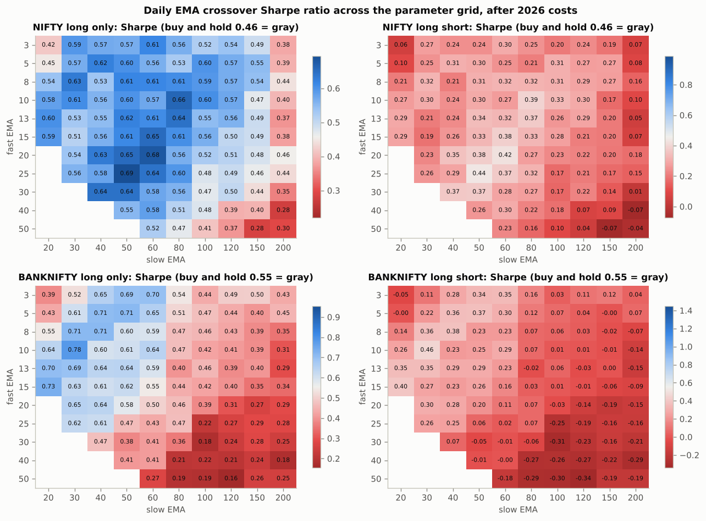
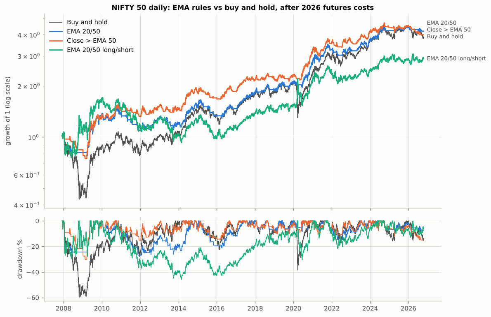
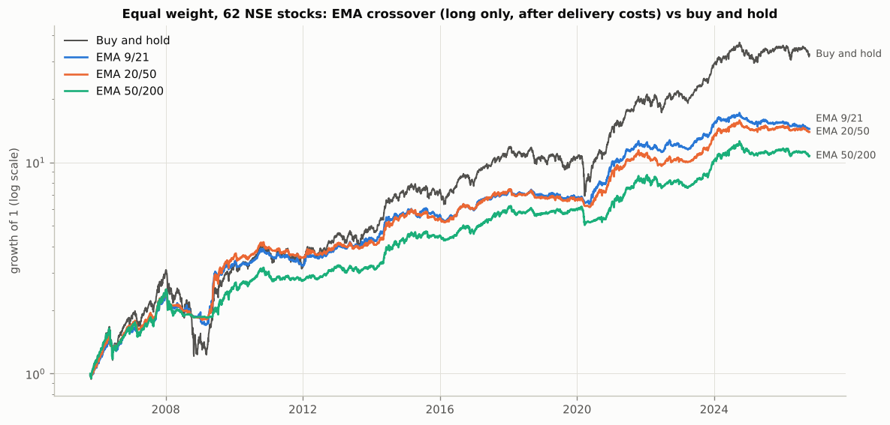
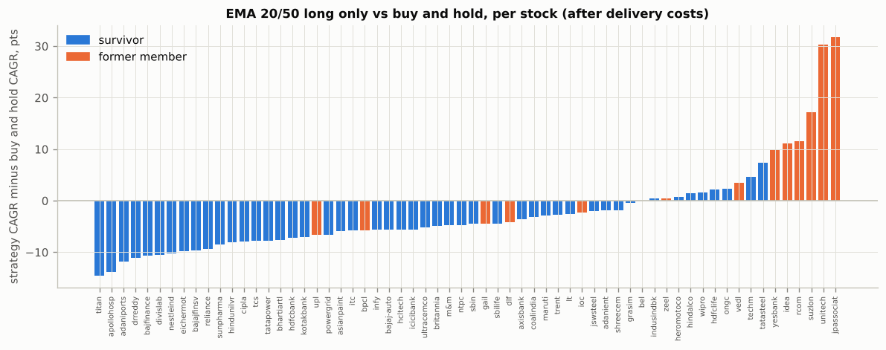

# Daily EMA crossover results

Generated by `scripts/run_ema_daily.py`. All fills at the next bar's open, costs per side as in `ema_lab/costs.py`. Win rate = share of trades with a positive return after costs. `p_random` = share of 1000 random-entry strategies (same trade count, holding periods and direction) with a mean trade at least as good; below 0.05 suggests the timing is doing something.

## A1. Classic EMA pairs on NIFTY and BANKNIFTY (daily, 2026 futures costs)

**NIFTY**, statistics from 05 Dec 2007 (after a 200 bar EMA warm-up on data from Jan 2007) to 13 Oct 2026

| rule | side | trades | win_rate | profit_factor | expectancy_bps | cagr | sharpe | max_dd | exposure | trades_per_year | p_random |
|---|---|---|---|---|---|---|---|---|---|---|---|
| EMA 5/20 | long_only | 137 | 35.8% | 1.68 | 83.3 | 4.9% | 0.45 | -25.0% | 60.6% | 7.27 | 0.49 |
| EMA 5/20 | long_short | 275 | 29.8% | 1.13 | 19.0 | -0.1% | 0.10 | -55.5% | 100.0% | 14.58 | 0.40 |
| EMA 9/21 | long_only | 92 | 42.4% | 2.20 | 163.9 | 6.8% | 0.59 | -28.6% | 61.4% | 4.88 | 0.33 |
| EMA 9/21 | long_short | 185 | 35.1% | 1.45 | 68.0 | 3.5% | 0.27 | -38.4% | 100.0% | 9.81 | 0.18 |
| EMA 12/26 | long_only | 65 | 49.2% | 2.69 | 247.3 | 6.9% | 0.60 | -37.4% | 62.3% | 3.45 | 0.29 |
| EMA 12/26 | long_short | 131 | 42.0% | 1.62 | 106.8 | 3.8% | 0.29 | -41.0% | 100.0% | 6.95 | 0.15 |
| EMA 20/50 | long_only | 34 | 52.9% | 4.00 | 565.2 | 7.9% | 0.65 | -27.4% | 65.1% | 1.80 | 0.20 |
| EMA 20/50 | long_short | 69 | 44.9% | 2.38 | 273.3 | 5.8% | 0.38 | -45.7% | 100.0% | 3.66 | 0.08 |
| EMA 50/100 | long_only | 16 | 50.0% | 3.64 | 848.5 | 4.8% | 0.41 | -29.8% | 69.0% | 0.85 | 0.51 |
| EMA 50/100 | long_short | 33 | 36.4% | 1.58 | 245.9 | -0.0% | 0.10 | -55.7% | 100.0% | 1.75 | 0.47 |
| EMA 50/200 | long_only | 17 | 35.3% | 2.17 | 515.0 | 3.3% | 0.30 | -31.0% | 75.2% | 0.90 | 0.83 |
| EMA 50/200 | long_short | 34 | 23.5% | 1.05 | 24.2 | -2.7% | -0.04 | -68.3% | 100.0% | 1.80 | 0.89 |

Buy and hold: CAGR 7.5%, Sharpe 0.46, max drawdown -59.7%.

**BANKNIFTY**, statistics from 15 Dec 2010 (after a 200 bar EMA warm-up on data from Mar 2010) to 13 Oct 2026

| rule | side | trades | win_rate | profit_factor | expectancy_bps | cagr | sharpe | max_dd | exposure | trades_per_year | p_random |
|---|---|---|---|---|---|---|---|---|---|---|---|
| EMA 5/20 | long_only | 115 | 35.7% | 1.59 | 93.9 | 5.3% | 0.43 | -32.5% | 59.0% | 7.27 | 0.56 |
| EMA 5/20 | long_short | 230 | 30.4% | 1.05 | 9.6 | -2.5% | -0.00 | -49.9% | 100.0% | 14.53 | 0.50 |
| EMA 9/21 | long_only | 82 | 42.7% | 2.30 | 185.3 | 8.5% | 0.64 | -30.2% | 59.8% | 5.18 | 0.35 |
| EMA 9/21 | long_short | 164 | 36.6% | 1.36 | 64.3 | 3.4% | 0.26 | -44.9% | 100.0% | 10.36 | 0.23 |
| EMA 12/26 | long_only | 60 | 48.3% | 3.66 | 326.7 | 11.3% | 0.81 | -23.0% | 61.8% | 3.79 | 0.20 |
| EMA 12/26 | long_short | 120 | 43.3% | 2.00 | 157.7 | 9.0% | 0.50 | -35.0% | 100.0% | 7.58 | 0.06 |
| EMA 20/50 | long_only | 32 | 43.8% | 3.32 | 450.3 | 7.7% | 0.58 | -21.8% | 64.5% | 2.02 | 0.44 |
| EMA 20/50 | long_short | 64 | 31.2% | 1.54 | 145.5 | 2.0% | 0.20 | -46.5% | 100.0% | 4.04 | 0.37 |
| EMA 50/100 | long_only | 19 | 47.4% | 1.71 | 321.9 | 1.7% | 0.19 | -37.8% | 69.2% | 1.20 | 0.87 |
| EMA 50/100 | long_short | 39 | 33.3% | 0.68 | -199.8 | -8.8% | -0.30 | -77.3% | 100.0% | 2.46 | 0.95 |
| EMA 50/200 | long_only | 15 | 40.0% | 1.93 | 449.7 | 2.9% | 0.25 | -34.7% | 77.3% | 0.95 | 0.92 |
| EMA 50/200 | long_short | 30 | 20.0% | 0.72 | -180.1 | -6.5% | -0.19 | -67.3% | 100.0% | 1.90 | 0.98 |

Buy and hold: CAGR 10.4%, Sharpe 0.55, max drawdown -47.9%.

## A2. Parameter grid (99 fast/slow pairs per market and side)

| market | side | pairs | beats B&H Sharpe | beats B&H CAGR | PF > 1 | median_sharpe | best_sharpe | best_pair | median_win_rate | bh_sharpe | luck_threshold_sharpe |
|---|---|---|---|---|---|---|---|---|---|---|---|
| BANKNIFTY | long_only | 99 | 30.3% | 1.0% | 100.0% | 0.44 | 0.78 | 10/30 | 43.5% | 0.55 | 0.84 |
| BANKNIFTY | long_short | 99 | 0.0% | 0.0% | 72.7% | 0.04 | 0.46 | 10/30 | 31.4% | 0.55 | 0.54 |
| NIFTY | long_only | 99 | 80.8% | 11.1% | 100.0% | 0.56 | 0.69 | 25/50 | 42.2% | 0.46 | 0.78 |
| NIFTY | long_short | 99 | 0.0% | 0.0% | 99.0% | 0.25 | 0.44 | 25/50 | 33.3% | 0.46 | 0.51 |

`luck_threshold_sharpe` is the grid median plus the expected maximum of 99 zero-skill trials (Bailey and Lopez de Prado); a best pair below it is consistent with data mining luck.

## A3. Filters and EMA family variants (daily, 2026 futures costs)

**NIFTY**

| rule | trades | win_rate | profit_factor | expectancy_bps | cagr | sharpe | max_dd | exposure | trades_per_year | p_random |
|---|---|---|---|---|---|---|---|---|---|---|
| EMA 20/50 | 34 | 52.9% | 4.00 | 565.2 | 7.9% | 0.65 | -27.4% | 65.1% | 1.80 | 0.20 |
| EMA 20/50 + close > EMA 200 | 28 | 46.4% | 1.93 | 229.8 | 2.6% | 0.33 | -38.1% | 46.7% | 1.48 | 0.67 |
| EMA 20/50 + ADX > 20 | 11 | 45.5% | 4.59 | 706.6 | 3.3% | 0.42 | -22.2% | 21.9% | 0.58 | 0.20 |
| EMA 20/50 + 2 ATR stop | 34 | 38.2% | 2.79 | 353.0 | 4.3% | 0.42 | -28.4% | 45.9% | 1.80 | 0.29 |
| EMA 20/50 + 3 ATR trailing stop | 34 | 44.1% | 2.34 | 199.5 | 3.2% | 0.43 | -26.0% | 22.4% | 1.80 | 0.25 |
| EMA 9/21 + close > EMA 200 | 68 | 45.6% | 2.31 | 145.4 | 4.8% | 0.56 | -16.6% | 46.0% | 3.61 | 0.44 |
| Triple EMA 10/20/50 | 70 | 47.1% | 2.48 | 191.2 | 6.3% | 0.60 | -28.8% | 53.4% | 3.71 | 0.32 |
| MACD 12/26/9 | 178 | 38.2% | 1.45 | 49.4 | 4.0% | 0.38 | -27.8% | 49.0% | 9.44 | 0.46 |
| Close > EMA 50 | 160 | 28.7% | 2.15 | 104.6 | 7.6% | 0.65 | -30.3% | 64.1% | 8.49 | 0.23 |
| Close > EMA 100 | 121 | 29.8% | 2.36 | 137.1 | 6.6% | 0.57 | -26.4% | 67.3% | 6.42 | 0.30 |
| Close > EMA 200 | 78 | 24.4% | 2.01 | 151.4 | 4.7% | 0.41 | -40.6% | 72.9% | 4.14 | 0.65 |
| EMA 20/50 long/short | 69 | 44.9% | 2.38 | 273.3 | 5.8% | 0.38 | -45.7% | 100.0% | 3.66 | 0.08 |
| EMA 20/50 long/short + EMA 200 regime | 40 | 45.0% | 1.92 | 216.8 | 2.9% | 0.26 | -48.6% | 61.1% | 2.12 | 0.36 |
| EMA 20/50 long/short + ADX > 25 | 14 | 42.9% | 3.46 | 437.9 | 2.2% | 0.27 | -17.8% | 23.0% | 0.74 | 0.12 |
| MACD 12/26/9 long/short | 356 | 33.7% | 1.01 | 1.6 | -1.9% | 0.01 | -62.9% | 100.0% | 18.88 | 0.35 |

**BANKNIFTY**

| rule | trades | win_rate | profit_factor | expectancy_bps | cagr | sharpe | max_dd | exposure | trades_per_year | p_random |
|---|---|---|---|---|---|---|---|---|---|---|
| EMA 20/50 | 32 | 43.8% | 3.32 | 450.3 | 7.7% | 0.58 | -21.8% | 64.5% | 2.02 | 0.44 |
| EMA 20/50 + close > EMA 200 | 27 | 44.4% | 2.57 | 332.7 | 4.6% | 0.44 | -21.8% | 52.0% | 1.71 | 0.60 |
| EMA 20/50 + ADX > 20 | 14 | 57.1% | 5.50 | 810.4 | 6.2% | 0.63 | -20.3% | 35.0% | 0.88 | 0.23 |
| EMA 20/50 + 2 ATR stop | 32 | 34.4% | 2.99 | 371.9 | 6.1% | 0.50 | -23.7% | 54.1% | 2.02 | 0.46 |
| EMA 20/50 + 3 ATR trailing stop | 32 | 43.8% | 2.86 | 256.6 | 4.7% | 0.55 | -15.4% | 25.5% | 2.02 | 0.23 |
| EMA 9/21 + close > EMA 200 | 64 | 40.6% | 1.44 | 64.5 | 2.1% | 0.25 | -32.8% | 41.8% | 4.04 | 0.76 |
| Triple EMA 10/20/50 | 69 | 42.0% | 2.14 | 157.9 | 6.0% | 0.52 | -23.7% | 52.0% | 4.36 | 0.51 |
| MACD 12/26/9 | 155 | 37.4% | 1.41 | 61.6 | 4.8% | 0.39 | -29.7% | 47.6% | 9.79 | 0.44 |
| Close > EMA 50 | 161 | 34.8% | 1.90 | 93.1 | 7.9% | 0.59 | -31.5% | 62.8% | 10.17 | 0.33 |
| Close > EMA 100 | 99 | 35.4% | 1.97 | 129.6 | 6.1% | 0.47 | -30.7% | 67.2% | 6.25 | 0.56 |
| Close > EMA 200 | 77 | 28.6% | 1.94 | 143.6 | 5.2% | 0.40 | -40.0% | 73.1% | 4.86 | 0.70 |
| EMA 20/50 long/short | 64 | 31.2% | 1.54 | 145.5 | 2.0% | 0.20 | -46.5% | 100.0% | 4.04 | 0.37 |
| EMA 20/50 long/short + EMA 200 regime | 39 | 43.6% | 1.61 | 172.0 | 2.1% | 0.21 | -36.4% | 67.8% | 2.46 | 0.56 |
| EMA 20/50 long/short + ADX > 25 | 16 | 31.2% | 3.35 | 631.5 | 4.5% | 0.38 | -44.3% | 33.5% | 1.01 | 0.06 |
| MACD 12/26/9 long/short | 309 | 33.0% | 0.98 | -3.5 | -3.3% | -0.04 | -60.0% | 100.0% | 19.52 | 0.42 |

## A3b. Total return view (6% a year on idle cash, 1.3% dividend yield while long)

Price-only backtests penalise rules that spend a third of the time in cash. With a constant 6% cash yield (overnight TREPS averaged about 5.4% over 2016-2026 per the NIFTY 1D Rate Index, T-bills were higher before) and 1.3% dividends for whoever holds the index:

| market | rule | cagr | sharpe | max_dd | bh_cagr | bh_sharpe | bh_max_dd |
|---|---|---|---|---|---|---|---|
| NIFTY | EMA 20/50 | 11.0% | 0.87 | -23.6% | 8.8% | 0.52 | -59.3% |
| NIFTY | EMA 20/50 + 3 ATR trailing stop | 8.2% | 1.05 | -13.2% | 8.8% | 0.52 | -59.3% |
| NIFTY | Triple EMA 10/20/50 | 9.9% | 0.90 | -19.2% | 8.8% | 0.52 | -59.3% |
| NIFTY | Close > EMA 50 | 10.8% | 0.89 | -26.4% | 8.8% | 0.52 | -59.3% |
| NIFTY | EMA 20/50 long/short | 6.2% | 0.40 | -45.2% | 8.8% | 0.52 | -59.3% |
| BANKNIFTY | EMA 20/50 | 10.9% | 0.77 | -20.4% | 11.9% | 0.61 | -47.7% |
| BANKNIFTY | EMA 20/50 + 3 ATR trailing stop | 9.7% | 1.08 | -11.6% | 11.9% | 0.61 | -47.7% |
| BANKNIFTY | Triple EMA 10/20/50 | 9.8% | 0.80 | -21.5% | 11.9% | 0.61 | -47.7% |
| BANKNIFTY | Close > EMA 50 | 11.2% | 0.79 | -28.7% | 11.9% | 0.61 | -47.7% |
| BANKNIFTY | EMA 20/50 long/short | 2.4% | 0.22 | -45.5% | 11.9% | 0.61 | -47.7% |

## A4. Pick the best pair in-sample, test it out-of-sample

| market | side | in_sample | best_is_pair | is_sharpe | oos_sharpe | oos_rank | oos_cagr | oos_max_dd | oos win rate | oos_bh_sharpe | oos_bh_cagr | is_oos_rank_corr |
|---|---|---|---|---|---|---|---|---|---|---|---|---|
| NIFTY | long_only | to 2016 | 5/100 | 0.48 | 0.77 | 62 of 99 | 8.0% | -17.6% | 41.2% | 0.73 | 11.0% | 0.34 |
| NIFTY | long_short | to 2016 | 10/80 | 0.33 | 0.49 | 21 of 99 | 6.8% | -29.3% | 31.2% | 0.73 | 11.0% | 0.26 |
| BANKNIFTY | long_only | to 2017 | 20/40 | 0.82 | 0.48 | 31 of 99 | 6.0% | -21.7% | 50.0% | 0.51 | 9.2% | 0.79 |
| BANKNIFTY | long_short | to 2017 | 10/30 | 0.49 | 0.43 | 1 of 99 | 7.2% | -26.9% | 44.8% | 0.51 | 9.2% | 0.77 |

`is_oos_rank_corr` is the Spearman correlation between in-sample and out-of-sample Sharpe across all grid pairs: near zero means past parameter rankings told you nothing about future ones.

## A5. NIFTY calendar year returns (from 05 Dec 2007, after the 200 bar warm-up)

| year | NIFTY buy and hold_pct | EMA 20/50 long only_pct | EMA 20/50 long/short_pct |
|---|---|---|---|
| 2007 | 4.5% | 4.5% | 4.5% |
| 2008 | -51.7% | -22.4% | 4.3% |
| 2009 | 76.1% | 67.5% | 54.5% |
| 2010 | 17.6% | 2.5% | -11.5% |
| 2011 | -24.7% | -21.4% | -20.8% |
| 2012 | 27.9% | 17.8% | 7.9% |
| 2013 | 6.8% | -5.8% | -18.5% |
| 2014 | 31.4% | 25.6% | 20.0% |
| 2015 | -4.1% | -12.6% | -21.4% |
| 2016 | 3.0% | 10.1% | 16.2% |
| 2017 | 28.6% | 25.3% | 21.9% |
| 2018 | 3.2% | 3.4% | 2.8% |
| 2019 | 12.0% | 10.6% | 8.3% |
| 2020 | 14.9% | 32.4% | 41.0% |
| 2021 | 24.1% | 16.9% | 9.7% |
| 2022 | 4.3% | -0.3% | -6.4% |
| 2023 | 20.0% | 15.7% | 11.2% |
| 2024 | 8.8% | 12.3% | 15.6% |
| 2025 | 10.5% | 5.5% | -0.1% |
| 2026 | -13.0% | -5.8% | 0.4% |

## B1. EMA crossovers on 62 NSE stocks (daily, long only, delivery costs ~29 bps round trip)

Survivors are current or recent Nifty 50 members; former members are stocks that dropped out of the index (Yes Bank, Vodafone Idea, RCom, Unitech, JP Associates, Suzlon, DLF, Zee, Vedanta, ...), included to blunt survivorship bias. Data from 2005 or listing date to Oct 2026.

| rule | group | stocks | median_cagr | median_bh_cagr | beats B&H CAGR | beats B&H Sharpe | PF > 1 | mean_win_rate | median_max_dd | median_bh_max_dd | median_trades_per_year |
|---|---|---|---|---|---|---|---|---|---|---|---|
| EMA 20/50 | all | 62 | 8.6% | 12.7% | 27.4% | 35.5% | 96.8% | 36.8% | -51.9% | -69.5% | 2.21 |
| EMA 20/50 | former member | 13 | 5.0% | -0.1% | 61.5% | 46.2% | 84.6% | 32.9% | -74.5% | -88.9% | 2.10 |
| EMA 20/50 | survivor | 49 | 8.8% | 13.8% | 18.4% | 32.7% | 100.0% | 37.9% | -49.4% | -66.4% | 2.22 |
| EMA 50/200 | all | 62 | 8.4% | 12.7% | 19.4% | 21.0% | 93.5% | 42.5% | -55.2% | -69.5% | 0.71 |
| EMA 50/200 | former member | 13 | 1.8% | -0.1% | 53.8% | 38.5% | 76.9% | 29.5% | -75.5% | -88.9% | 0.74 |
| EMA 50/200 | survivor | 49 | 10.2% | 13.8% | 10.2% | 16.3% | 98.0% | 45.9% | -52.5% | -66.4% | 0.71 |
| EMA 9/21 | all | 62 | 8.1% | 12.7% | 29.0% | 40.3% | 91.9% | 35.2% | -52.1% | -69.5% | 5.20 |
| EMA 9/21 | former member | 13 | 5.7% | -0.1% | 61.5% | 61.5% | 84.6% | 30.3% | -76.2% | -88.9% | 5.20 |
| EMA 9/21 | survivor | 49 | 9.1% | 13.8% | 20.4% | 34.7% | 93.9% | 36.5% | -48.0% | -66.4% | 5.19 |

## B2. Equal weight portfolios across the same 62 stocks

| portfolio | cagr | vol | sharpe | max_dd | calmar |
|---|---|---|---|---|---|
| EMA 9/21 | 13.6% | 11.0% | 1.21 | -28.5% | 0.48 |
| Buy and hold | 18.0% | 20.2% | 0.92 | -60.9% | 0.30 |
| EMA 20/50 | 13.4% | 11.5% | 1.15 | -28.0% | 0.48 |
| EMA 50/200 | 12.0% | 12.4% | 0.97 | -28.6% | 0.42 |

## C1. Global markets (OANDA CFDs Jan 2005 to May 2020, Bitstamp BTC 2012-2017)

Daily bars, after spread and slippage costs. `p_random` is the random entry test.

| market | rule | side | trades | win_rate | profit_factor | expectancy_bps | cagr | sharpe | max_dd | exposure | trades_per_year | bh_cagr | p_random |
|---|---|---|---|---|---|---|---|---|---|---|---|---|---|
| SPX500_USD | EMA 9/21 | long_only | 87 | 39.1% | 1.23 | 32.2 | 1.4% | 0.19 | -32.1% | 66.7% | 5.96 | 6.1% | 0.79 |
| SPX500_USD | EMA 9/21 | long_short | 173 | 29.5% | 0.84 | -25.4 | -5.8% | -0.20 | -67.0% | 100.0% | 11.86 | 6.1% | 0.87 |
| SPX500_USD | EMA 20/50 | long_only | 29 | 51.7% | 2.70 | 262.8 | 4.7% | 0.47 | -22.5% | 71.6% | 1.99 | 6.1% | 0.52 |
| SPX500_USD | EMA 20/50 | long_short | 57 | 35.1% | 1.41 | 85.8 | 0.4% | 0.12 | -37.2% | 100.0% | 3.91 | 6.1% | 0.51 |
| SPX500_USD | EMA 50/200 | long_only | 10 | 70.0% | 3.88 | 763.9 | 4.2% | 0.37 | -28.8% | 79.3% | 0.69 | 6.1% | 0.64 |
| SPX500_USD | EMA 50/200 | long_short | 20 | 40.0% | 1.48 | 210.2 | -0.0% | 0.10 | -50.1% | 100.0% | 1.37 | 6.1% | 0.66 |
| NAS100_USD | EMA 9/21 | long_only | 83 | 38.6% | 1.96 | 135.1 | 6.9% | 0.59 | -23.3% | 67.8% | 5.69 | 12.9% | 0.66 |
| NAS100_USD | EMA 9/21 | long_short | 165 | 27.9% | 1.08 | 13.6 | -1.9% | 0.02 | -62.1% | 100.0% | 11.31 | 12.9% | 0.71 |
| NAS100_USD | EMA 20/50 | long_only | 39 | 51.3% | 2.11 | 232.9 | 5.1% | 0.43 | -28.0% | 71.9% | 2.67 | 12.9% | 0.81 |
| NAS100_USD | EMA 20/50 | long_short | 77 | 31.2% | 0.92 | -24.4 | -5.0% | -0.13 | -64.6% | 100.0% | 5.28 | 12.9% | 0.93 |
| NAS100_USD | EMA 50/200 | long_only | 11 | 63.6% | 8.34 | 1565.4 | 9.5% | 0.61 | -30.8% | 84.7% | 0.75 | 12.9% | 0.59 |
| NAS100_USD | EMA 50/200 | long_short | 21 | 38.1% | 2.32 | 580.1 | 4.2% | 0.30 | -40.9% | 100.0% | 1.44 | 12.9% | 0.68 |
| EUR_USD | EMA 9/21 | long_only | 89 | 28.1% | 1.02 | 2.0 | -0.1% | 0.02 | -29.6% | 50.0% | 6.10 | -0.8% | 0.35 |
| EUR_USD | EMA 9/21 | long_short | 178 | 26.4% | 1.04 | 3.7 | 0.2% | 0.07 | -39.0% | 100.0% | 12.20 | -0.8% | 0.42 |
| EUR_USD | EMA 20/50 | long_only | 43 | 30.2% | 0.78 | -28.8 | -1.0% | -0.13 | -29.2% | 53.3% | 2.95 | -0.8% | 0.61 |
| EUR_USD | EMA 20/50 | long_short | 86 | 25.6% | 0.83 | -23.0 | -1.7% | -0.14 | -41.6% | 100.0% | 5.89 | -0.8% | 0.69 |
| EUR_USD | EMA 50/200 | long_only | 9 | 33.3% | 1.32 | 53.7 | 0.2% | 0.07 | -22.6% | 47.8% | 0.62 | -0.8% | 0.37 |
| EUR_USD | EMA 50/200 | long_short | 19 | 36.8% | 1.54 | 91.7 | 0.7% | 0.12 | -29.4% | 100.0% | 1.30 | -0.8% | 0.28 |
| GBP_USD | EMA 9/21 | long_only | 99 | 28.3% | 0.55 | -40.9 | -2.9% | -0.42 | -36.7% | 49.8% | 6.78 | -2.5% | 0.79 |
| GBP_USD | EMA 9/21 | long_short | 198 | 24.7% | 0.72 | -24.5 | -3.8% | -0.35 | -45.3% | 100.0% | 13.57 | -2.5% | 0.90 |
| GBP_USD | EMA 20/50 | long_only | 33 | 45.5% | 1.04 | 4.7 | -0.0% | 0.03 | -19.2% | 51.2% | 2.26 | -2.5% | 0.24 |
| GBP_USD | EMA 20/50 | long_short | 66 | 37.9% | 1.46 | 50.1 | 2.0% | 0.25 | -20.7% | 100.0% | 4.52 | -2.5% | 0.16 |
| GBP_USD | EMA 50/200 | long_only | 10 | 30.0% | 0.45 | -149.9 | -1.1% | -0.19 | -24.9% | 43.0% | 0.69 | -2.5% | 0.53 |
| GBP_USD | EMA 50/200 | long_short | 21 | 33.3% | 1.04 | 9.7 | -0.4% | 0.01 | -33.6% | 100.0% | 1.44 | -2.5% | 0.52 |
| XAU_USD | EMA 9/21 | long_only | 76 | 34.2% | 1.71 | 97.5 | 4.8% | 0.43 | -31.0% | 55.1% | 5.68 | 7.9% | 0.42 |
| XAU_USD | EMA 9/21 | long_short | 151 | 31.1% | 1.15 | 22.2 | 0.4% | 0.11 | -40.5% | 100.0% | 11.28 | 7.9% | 0.32 |
| XAU_USD | EMA 20/50 | long_only | 33 | 48.5% | 2.22 | 221.5 | 4.6% | 0.41 | -32.3% | 59.1% | 2.47 | 7.9% | 0.44 |
| XAU_USD | EMA 20/50 | long_short | 66 | 36.4% | 1.17 | 40.8 | 0.0% | 0.09 | -46.2% | 100.0% | 4.93 | 7.9% | 0.44 |
| XAU_USD | EMA 50/200 | long_only | 6 | 50.0% | 17.21 | 2101.4 | 7.8% | 0.62 | -27.6% | 65.4% | 0.45 | 7.9% | 0.19 |
| XAU_USD | EMA 50/200 | long_short | 11 | 36.4% | 4.10 | 1091.9 | 6.3% | 0.43 | -36.4% | 100.0% | 0.82 | 7.9% | 0.12 |
| WTICO_USD | EMA 9/21 | long_only | 74 | 37.8% | 1.97 | 207.9 | 8.6% | 0.48 | -30.6% | 54.7% | 5.08 | -7.7% | 0.11 |
| WTICO_USD | EMA 9/21 | long_short | 148 | 30.4% | 1.69 | 175.4 | 15.4% | 0.56 | -61.8% | 100.0% | 10.16 | -7.7% | 0.04 |
| WTICO_USD | EMA 20/50 | long_only | 33 | 39.4% | 1.68 | 270.7 | 3.4% | 0.26 | -43.7% | 56.7% | 2.26 | -7.7% | 0.35 |
| WTICO_USD | EMA 20/50 | long_short | 67 | 34.3% | 1.52 | 235.0 | 4.1% | 0.30 | -75.7% | 100.0% | 4.60 | -7.7% | 0.17 |
| WTICO_USD | EMA 50/200 | long_only | 15 | 20.0% | 0.83 | -98.5 | -2.1% | 0.01 | -66.0% | 59.3% | 1.03 | -7.7% | 0.70 |
| WTICO_USD | EMA 50/200 | long_short | 30 | 20.0% | 1.03 | 19.9 | -6.4% | 0.02 | -93.0% | 100.0% | 2.06 | -7.7% | 0.51 |
| BTC_USD | EMA 9/21 | long_only | 38 | 44.7% | 13.91 | 3696.9 | 216.6% | 1.95 | -79.0% | 64.9% | 6.97 | 284.5% | 0.15 |
| BTC_USD | EMA 9/21 | long_short | 77 | 35.1% | 4.06 | 1621.3 | 93.3% | 1.20 | -92.1% | 100.0% | 14.13 | 284.5% | 0.08 |
| BTC_USD | EMA 20/50 | long_only | 10 | 80.0% | 114 | 19809.3 | 296.0% | 2.11 | -70.3% | 69.0% | 1.83 | 284.5% | 0.08 |
| BTC_USD | EMA 20/50 | long_short | 20 | 60.0% | 19.42 | 9825.5 | 240.7% | 1.81 | -70.3% | 100.0% | 3.67 | 284.5% | 0.04 |
| BTC_USD | EMA 50/200 | long_only | 3 | 66.7% | 390 | 307566.8 | 290.7% | 2.03 | -71.2% | 76.0% | 0.55 | 284.5% | 0.17 |
| BTC_USD | EMA 50/200 | long_short | 5 | 60.0% | 134 | 184337.7 | 254.8% | 1.85 | -82.8% | 99.9% | 0.92 | 284.5% | 0.17 |

Hourly bars, same rules (the EMA lengths now span hours, not days):

| market | rule | side | trades | win_rate | profit_factor | expectancy_bps | cagr | sharpe | max_dd | trades_per_year |
|---|---|---|---|---|---|---|---|---|---|---|
| SPX500_USD | EMA 9/21 | long_only | 1988 | 31.8% | 0.97 | -1.0 | -1.9% | -0.08 | -40.7% | 130 |
| SPX500_USD | EMA 9/21 | long_short | 3977 | 28.5% | 0.89 | -3.7 | -11.1% | -0.51 | -85.0% | 259 |
| SPX500_USD | EMA 20/50 | long_only | 874 | 34.6% | 0.98 | -0.8 | -1.1% | -0.03 | -46.7% | 57.01 |
| SPX500_USD | EMA 20/50 | long_short | 1749 | 28.8% | 0.86 | -6.9 | -9.7% | -0.44 | -83.5% | 114 |
| SPX500_USD | EMA 50/200 | long_only | 283 | 33.2% | 1.11 | 8.6 | 1.0% | 0.15 | -38.8% | 18.46 |
| SPX500_USD | EMA 50/200 | long_short | 567 | 27.0% | 0.88 | -10.3 | -6.0% | -0.22 | -74.6% | 36.98 |
| NAS100_USD | EMA 9/21 | long_only | 1932 | 32.8% | 1.03 | 1.1 | 0.4% | 0.10 | -43.4% | 126 |
| NAS100_USD | EMA 9/21 | long_short | 3865 | 28.4% | 0.90 | -4.2 | -12.4% | -0.50 | -88.2% | 252 |
| NAS100_USD | EMA 20/50 | long_only | 838 | 34.0% | 1.11 | 6.8 | 2.7% | 0.26 | -45.6% | 54.66 |
| NAS100_USD | EMA 20/50 | long_short | 1677 | 28.2% | 0.91 | -5.4 | -8.5% | -0.31 | -77.2% | 109 |
| NAS100_USD | EMA 50/200 | long_only | 271 | 35.8% | 1.33 | 31.6 | 4.7% | 0.43 | -31.3% | 17.68 |
| NAS100_USD | EMA 50/200 | long_short | 542 | 27.3% | 0.94 | -6.1 | -5.1% | -0.13 | -68.9% | 35.35 |
| EUR_USD | EMA 9/21 | long_only | 2095 | 28.2% | 0.89 | -2.1 | -3.1% | -0.43 | -40.5% | 137 |
| EUR_USD | EMA 9/21 | long_short | 4191 | 28.3% | 0.91 | -1.8 | -5.3% | -0.51 | -59.6% | 273 |
| EUR_USD | EMA 20/50 | long_only | 919 | 28.7% | 0.86 | -4.1 | -2.7% | -0.37 | -42.4% | 59.93 |
| EUR_USD | EMA 20/50 | long_short | 1839 | 29.1% | 0.88 | -3.5 | -4.6% | -0.43 | -59.8% | 120 |
| EUR_USD | EMA 50/200 | long_only | 290 | 29.0% | 0.94 | -2.7 | -0.7% | -0.08 | -22.7% | 18.91 |
| EUR_USD | EMA 50/200 | long_short | 581 | 29.4% | 0.99 | -0.3 | -0.6% | -0.01 | -28.2% | 37.89 |
| GBP_USD | EMA 9/21 | long_only | 2066 | 27.6% | 0.86 | -2.6 | -3.7% | -0.53 | -46.4% | 135 |
| GBP_USD | EMA 9/21 | long_short | 4133 | 27.7% | 0.91 | -1.8 | -5.1% | -0.47 | -60.0% | 270 |
| GBP_USD | EMA 20/50 | long_only | 894 | 29.9% | 0.92 | -2.3 | -1.6% | -0.20 | -34.0% | 58.30 |
| GBP_USD | EMA 20/50 | long_short | 1789 | 30.4% | 0.99 | -0.3 | -0.8% | -0.03 | -43.9% | 117 |
| GBP_USD | EMA 50/200 | long_only | 308 | 29.2% | 0.77 | -11.3 | -2.4% | -0.34 | -33.9% | 20.09 |
| GBP_USD | EMA 50/200 | long_short | 617 | 28.0% | 0.89 | -5.1 | -2.5% | -0.21 | -39.6% | 40.24 |
| XAU_USD | EMA 9/21 | long_only | 1820 | 30.5% | 1.17 | 5.3 | 6.2% | 0.53 | -31.1% | 129 |
| XAU_USD | EMA 9/21 | long_short | 3640 | 28.6% | 1.05 | 1.7 | 2.6% | 0.23 | -48.9% | 258 |
| XAU_USD | EMA 20/50 | long_only | 787 | 32.0% | 1.22 | 10.8 | 5.4% | 0.47 | -36.6% | 55.72 |
| XAU_USD | EMA 20/50 | long_short | 1574 | 29.9% | 1.05 | 2.6 | 1.2% | 0.16 | -57.0% | 111 |
| XAU_USD | EMA 50/200 | long_only | 252 | 31.7% | 1.55 | 40.6 | 6.7% | 0.57 | -23.8% | 17.84 |
| XAU_USD | EMA 50/200 | long_short | 503 | 30.0% | 1.19 | 15.3 | 3.7% | 0.29 | -31.6% | 35.61 |
| WTICO_USD | EMA 9/21 | long_only | 1946 | 29.8% | 1.04 | 2.8 | 0.6% | 0.15 | -58.0% | 127 |
| WTICO_USD | EMA 9/21 | long_short | 3892 | 28.8% | 1.04 | 2.4 | -1.1% | 0.16 | -76.8% | 254 |
| WTICO_USD | EMA 20/50 | long_only | 801 | 33.5% | 1.10 | 10.4 | 2.6% | 0.23 | -57.7% | 52.24 |
| WTICO_USD | EMA 20/50 | long_short | 1602 | 32.3% | 1.08 | 8.7 | 2.6% | 0.26 | -65.8% | 104 |
| WTICO_USD | EMA 50/200 | long_only | 271 | 31.7% | 1.22 | 36.3 | 3.8% | 0.27 | -51.5% | 17.68 |
| WTICO_USD | EMA 50/200 | long_short | 541 | 29.0% | 1.17 | 30.3 | 4.2% | 0.30 | -80.1% | 35.29 |
| BTC_USD | EMA 9/21 | long_only | 1241 | 25.0% | 1.20 | 23.5 | 23.8% | 0.65 | -99.1% | 208 |
| BTC_USD | EMA 9/21 | long_short | 2482 | 21.6% | 0.86 | -17.7 | -81.1% | -0.99 | -100.0% | 415 |
| BTC_USD | EMA 20/50 | long_only | 469 | 32.4% | 2.00 | 157.5 | 141.8% | 1.65 | -75.6% | 78.47 |
| BTC_USD | EMA 20/50 | long_short | 938 | 27.5% | 1.27 | 46.5 | -20.4% | 0.29 | -98.6% | 157 |
| BTC_USD | EMA 50/200 | long_only | 126 | 29.4% | 4.80 | 1068.4 | 175.7% | 1.84 | -81.5% | 21.08 |
| BTC_USD | EMA 50/200 | long_short | 252 | 27.0% | 2.31 | 445.4 | 15.2% | 0.71 | -97.8% | 42.16 |

